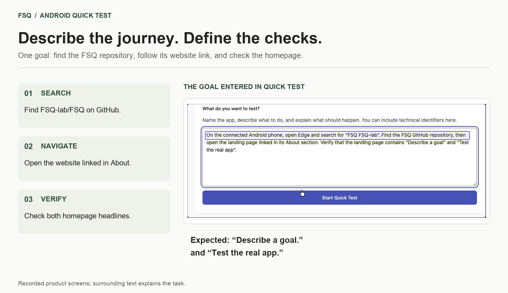
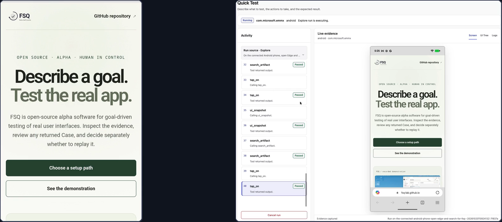
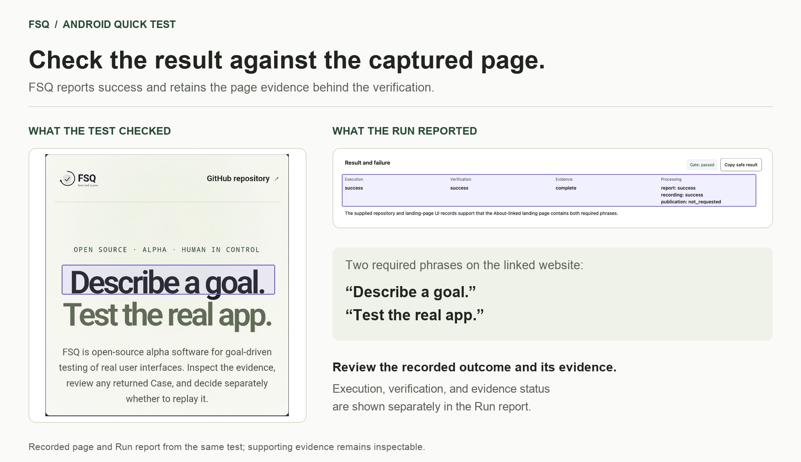

<p align="center">
  <picture>
    <source media="(prefers-color-scheme: dark)" srcset="docs/assets/logo-dark.svg">
    <source media="(prefers-color-scheme: light)" srcset="docs/assets/logo-light.svg">
    
  </picture>
</p>

<h3 align="center">Describe a goal. Test the real app.</h3>

<p align="center">Describe what to do and what should happen. Let AI operate the real app and verify the outcome. Inspect screenshots, actions, and results to see what happened.</p>

<p align="center">An open-source project from <a href="https://github.com/FSQ-lab">FSQ Lab</a>.</p>

<p align="center">
  <a href="https://github.com/FSQ-lab/FSQ/actions/workflows/ci.yml"></a>
  <a href="https://www.python.org/downloads/"></a>
  <a href="LICENSE"></a>
  
</p>

<p align="center">
  <a href="https://fsq-lab.github.io/FSQ/">Website</a> ·
  <a href="#quick-start">Quick start</a> ·
  <a href="README.zh-CN.md">中文</a> ·
  <a href="docs/getting-started.md">Guide</a> ·
  <a href="CONTRIBUTING.md">Contribute</a>
</p>

## See a complete test

https://github.com/user-attachments/assets/3acfecf4-bf48-4c76-8245-2eeef0dedb1f

[Watch on YouTube](https://youtu.be/f1sobvVHNg0) · [English captions](docs/media/quick-test.en.srt) · [Media sources and review status](docs/media/quick-test-demo-provenance.md)

The video shows one real Android Quick Test: find the FSQ repository, follow its About website link, and verify both homepage headlines. You can start with Web; platform setup and execution differ, and search results and outcomes can vary.

## From goal to evidence

**Describe the journey and the checks.** Find `FSQ-lab/FSQ`, follow its About website link, and verify `Describe a goal.` and `Test the real app.`. The card adds editorial explanation around a recorded goal; the surrounding text is separate from the product UI.



**Watch AI operate the real app.** The Android browser screen sits beside the FSQ action timeline, connecting execution with captured screenshots and interface state.



**Check the result against the evidence.** The captured page shows both required headlines. The same Run reports execution success, verification success, and complete evidence separately. The card pairs real page and report captures with editorial explanation.



## Quick start

Choose **Coding Agent** or **FSQ UI**. Both lead to one Quick Test and evidence review. You need Python 3.11+, a supported configured Provider and explicitly selected model, and [platform prerequisites](docs/platform-prerequisites.md). Enter Provider credentials privately in local FSQ Settings; never paste them into Coding Agent chat.

Quick Test prepares `~/.fsq/quick-test/` automatically. It requires no manual project Workspace setup, does not save a formal Case, and does not perform Strict Replay.

### Coding Agent

Add the FSQ Skill, reload your Coding Agent, and ask it to run the complete goal below with FSQ Quick Test.

<details>
<summary>Expand: one-time setup and first run</summary>

Open your project in the Coding Agent and paste:

> The official FSQ project is https://github.com/FSQ-lab/FSQ. Establish the exact opened project root. Batch and disclose read-only Python, fsq, and Skill-presence checks with their working directories, commands, purpose, and effects. Request one approval covering only installation or upgrade of fsq-agent and one fsq init --agent skill in this project; show exact commands and Python-environment and project-file effects first. Perform only approved operations, verify fsq, and report the installed Skill path. This setup does not initialize a Workspace, configure a Provider, or run a test. Ask me to reload or start a new Coding Agent session, then stop.

After reloading, select Web and an available browser, then send “Use FSQ Quick Test for the following goal” with the complete goal. Follow the installed Skill: it discovers readiness, asks for unresolved decisions, and reports actual progress and evidence. After a package upgrade, rerun `fsq init --agent skill` and reload to update the copied Skill.

</details>

[Open Coding Agent setup guide](docs/getting-started.md#coding-agent)

### FSQ UI

Install FSQ, open the local UI, choose **Quick Test**, and paste the same goal.

<details>
<summary>Expand: install and start Quick Test</summary>

```bash
python -m pip install --upgrade fsq-agent
fsq ui
```

1. Configure a supported Provider and explicitly select a model in **Settings**.
2. Return to **Quick Test**, select Web and an available browser, and paste the goal below.
3. Select **Start Quick Test**. FSQ interprets the app and validates the target and environment before testing. Unresolved intent, zero or multiple target matches, or preparation failure stop the request without follow-up dialogue.
4. Use **Open report** to inspect the outcome and evidence. Target availability does not prove the model understood the intended app correctly.

</details>

[Open FSQ UI setup guide](docs/getting-started.md#fsq-ui)

### Try a complete user journey

Web is an accessible first-use option; the recording shows Android. After selecting a browser, copy this complete goal into either entry path:

```text
Use the selected browser to search for the FSQ-lab/FSQ GitHub repository. Open that repository, follow the website link in its About section, and verify that the destination page displays both “Describe a goal.” and “Test the real app.” Report the outcome with the captured page evidence. Only browse public pages. Do not sign in, change repository content, or submit forms. Stop and report a blocker if the repository or About website link cannot be identified.
```

After the run, inspect the report and captured page evidence. Treat failed, inconclusive, or preparation-error outcomes as observed; they do not mean the checks passed.

## Go further when you need to

- **Inspect the run:** review screenshots, interface state, events, and reports to compare actual behavior with your expectations.
- **Manage reusable Cases:** use **FSQ Case Manager** for registered Workspaces, explicit Case creation or saving an available candidate, and run history. A run may produce a Case; generation is conditional.
- **Choose deterministic replay:** review any returned Case unchanged, then separately request Strict Replay. Replay operates the target again and requires prerequisite and side-effect checks; Quick Test never runs it automatically.

FSQ supports Web, Android, Windows, and macOS targets, subject to [platform prerequisites](docs/platform-prerequisites.md).

## Help shape FSQ

If FSQ is useful to you, [visit the repository and Star FSQ](https://github.com/FSQ-lab/FSQ) to help others discover it. Tried it? [Share your experience](https://github.com/FSQ-lab/FSQ/issues/new/choose): what worked, where you got stuck, and what you want to test next.

Include the FSQ version, platform, sanitized goal, expected and actual outcome, and only reviewed diagnostic excerpts. Remove credentials, personal data, private URLs, paths, and device identifiers before sharing screenshots or logs. Report security issues through [Security](SECURITY.md).

> [!IMPORTANT]
> FSQ is alpha software for evaluation and contribution. Evidence is stored locally and may contain private app data; review it before sharing, and do not commit evidence or credentials. AI operations send necessary provider-bound inputs to your configured Provider. Public interfaces may evolve before 1.0; see [support and stability](docs/support-and-stability.md).

## Documentation

- [Getting started](docs/getting-started.md)
- [中文快速开始](docs/getting-started.zh-CN.md)
- [CLI reference](docs/cli-reference.md)
- [FSQ Case format](docs/case-format.md)
- [Advanced Codex compatibility](docs/codex-integration.md)
- [Platform prerequisites](docs/platform-prerequisites.md)
- [Contribute](CONTRIBUTING.md)

Built by [FSQ Lab](https://github.com/FSQ-lab) and the community, with thanks to [all contributors](https://github.com/FSQ-lab/FSQ/graphs/contributors).

## License

[MIT](LICENSE) — Copyright (c) Microsoft Corporation.
