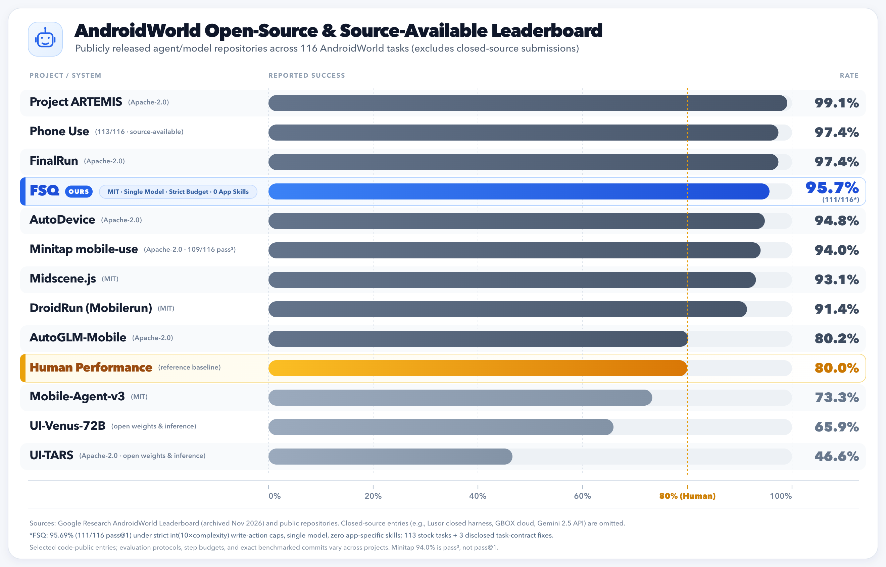
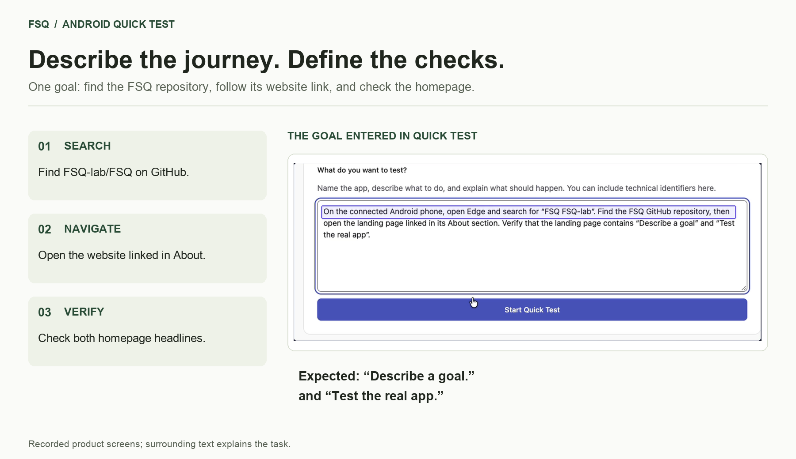
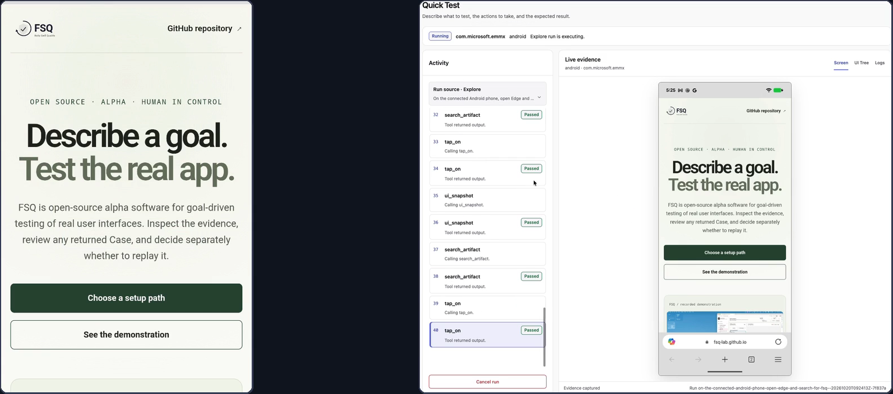
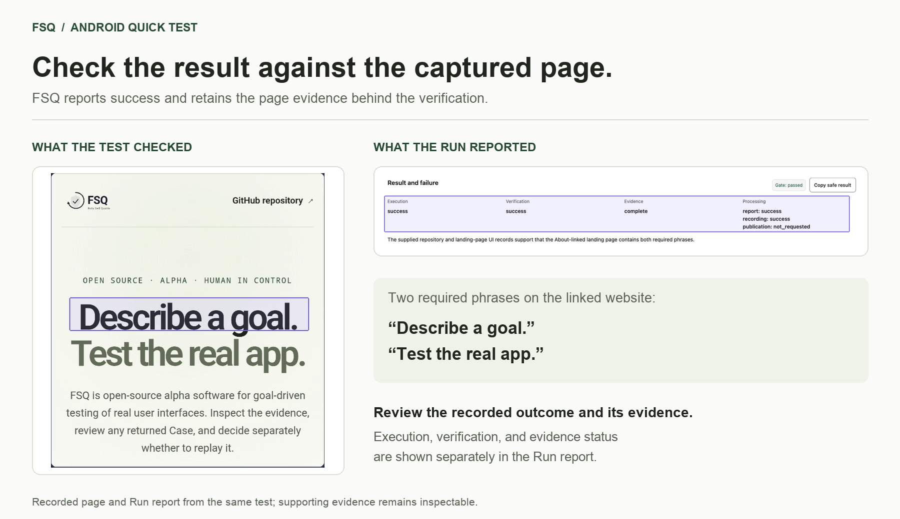

<p align="center">
  <picture>
    <source media="(prefers-color-scheme: dark)" srcset="docs/assets/logo-dark.svg">
    <source media="(prefers-color-scheme: light)" srcset="docs/assets/logo-light.svg">
    
  </picture>
</p>

<h3 align="center">Describe a goal. Test the real app.</h3>

<p align="center">Describe what to do and what should happen. Let AI operate the real app and verify the outcome. Inspect screenshots, actions, and results to see what happened.</p>

<p align="center">An open-source project from <a href="https://github.com/FSQ-lab">FSQ Lab</a>.</p>

<p align="center">
  <a href="https://github.com/FSQ-lab/FSQ/actions/workflows/ci.yml"></a>
  <a href="https://www.python.org/downloads/"></a>
  <a href="LICENSE"></a>
  
  <a href="https://github.com/FSQ-lab/benchmarks/tree/main/androidworld"></a>
</p>

<p align="center">
  <a href="https://fsq-lab.github.io/FSQ/">Website</a> ·
  <a href="#quick-start">Quick start</a> ·
  <a href="#benchmarks">Benchmarks</a> ·
  <a href="README.zh-CN.md">中文</a> ·
  <a href="docs/getting-started.md">Guide</a> ·
  <a href="CONTRIBUTING.md">Contribute</a>
</p>

## See a complete test

https://github.com/user-attachments/assets/3acfecf4-bf48-4c76-8245-2eeef0dedb1f

[YouTube](https://youtu.be/f1sobvVHNg0) · [English captions](docs/media/quick-test.en.srt) · [Media provenance](docs/media/quick-test-demo-provenance.md)

A real Android Quick Test, from goal to evidence. Try Web below; setup and execution differ across platforms,
and search results and outcomes can vary. This recording is an observation, not a success guarantee.

## Benchmarks

**95.69% (111/116, pass@1)** on AndroidWorld · **Single Model · Strict Budget · 0 App Skills**.

<p align="center"><a href="frontend/website/public/benchmarks/androidworld-leaderboard.png"></a></p>

Representative open-source and public-code snapshots from the November 2026 Google Research archive and public reports,
plus a **human reference**—not the complete leaderboard including closed-source submissions or an official same-protocol ranking.
Protocols, step budgets, and score-to-code
commit bindings differ. Phone Use's license is unverified; UI-Venus/UI-TARS provide weights and inference code,
not a verified complete score-producing AndroidWorld Harness. License labels do not certify the full evaluated stack;
using a commercial model API alone does not make an Agent closed source. **Minitap's 94.0% is pass³, not pass@1.**

FSQ uses **113 original tasks + three disclosed task-contract corrections and mode B**, not unmodified-upstream
or stock-strict grading. The image rounds 95.69% to **95.7%**; `111/116*` refers to these conditions.
[Full report](https://github.com/FSQ-lab/benchmarks/blob/main/androidworld/README.md) · [METHOD: frozen versions, budgets and audit limits](https://github.com/FSQ-lab/benchmarks/blob/main/androidworld/METHOD.md) · [Comparison provenance](frontend/website/public/benchmarks/leaderboard.json)

## Quick start

Choose **Coding Agent** or **FSQ UI**—equal paths to one Quick Test and evidence review. You need **Python 3.11+**,
a supported configured Provider, an **explicitly selected model**, and [platform prerequisites](docs/platform-prerequisites.md) for Web, Android, Windows, or macOS.
Enter credentials privately in local FSQ **Settings**, never in Coding Agent chat.

- **Coding Agent:** follow the [Skill setup guide](docs/getting-started.md#coding-agent), then reload your agent.
  Ask it to use FSQ Quick Test with Web, your selected available browser, and the complete goal below.
- **FSQ UI:** install and launch below, configure Provider/model in **Settings**, then choose **Quick Test**,
  select Web and an available browser, paste the goal, and select **Start Quick Test**. [UI guide](docs/getting-started.md#fsq-ui).

```bash
python -m pip install --upgrade fsq-agent
fsq ui
```

```text
Use the selected browser to search for the FSQ-lab/FSQ GitHub repository. Open that repository, follow the website link in its About section, and verify that the destination page displays both “Describe a goal.” and “Test the real app.” Report the outcome with the captured page evidence. Only browse public pages. Do not sign in, change repository content, or submit forms. Stop and report a blocker if the repository or About website link cannot be identified.
```

Quick Test prepares `~/.fsq/quick-test/` without manual project Workspace setup; it neither saves a formal Case
nor runs Strict Replay. Open the report and inspect captured evidence: failed, inconclusive, or preparation-error
outcomes do not mean the checks passed.

## From goal to evidence

**Describe the journey and checks.** This editorial task card explains the recorded goal; its annotations are not product UI.



**Watch the real app.** The Android browser and FSQ action timeline connect actions with screenshots and interface state.



**Inspect the result.** Real page and same-Run report captures separate execution, verification, and evidence completeness; surrounding explanations are editorial, not product UI.



## Go further when you need to

- **Inspect:** compare screenshots, interface state, events, and reports with your expectations.
- **Manage Cases:** FSQ Case Manager supports registered Workspaces, explicit Case creation or saving an available
  candidate, and run history. Case generation is conditional; not every run produces one.
- **Replay separately:** review any returned Case unchanged, then explicitly request Strict Replay. It operates the
  target again and requires prerequisite and side-effect checks; Quick Test never runs it automatically.

## Help shape FSQ

If useful, [Star FSQ](https://github.com/FSQ-lab/FSQ) or [share your experience](https://github.com/FSQ-lab/FSQ/issues/new/choose)—neither is required to try it.
Include version, platform, sanitized goal, expected/actual outcome, and reviewed diagnostic excerpts only.
Remove credentials, personal data, private URLs, paths, and device identifiers from screenshots/logs; use [Security](SECURITY.md) for security issues.

> **Alpha:** for evaluation and contribution; interfaces may evolve before 1.0. Evidence stays local and may contain
> private app data: review before sharing, and never commit evidence or credentials. AI operations send necessary
> provider-bound inputs to your configured Provider. See [support and stability](docs/support-and-stability.md).

## Documentation

[CLI reference](docs/cli-reference.md) · [Case format](docs/case-format.md) · [Advanced Codex compatibility](docs/codex-integration.md)

## License

[MIT](LICENSE) — Copyright (c) Microsoft Corporation.
