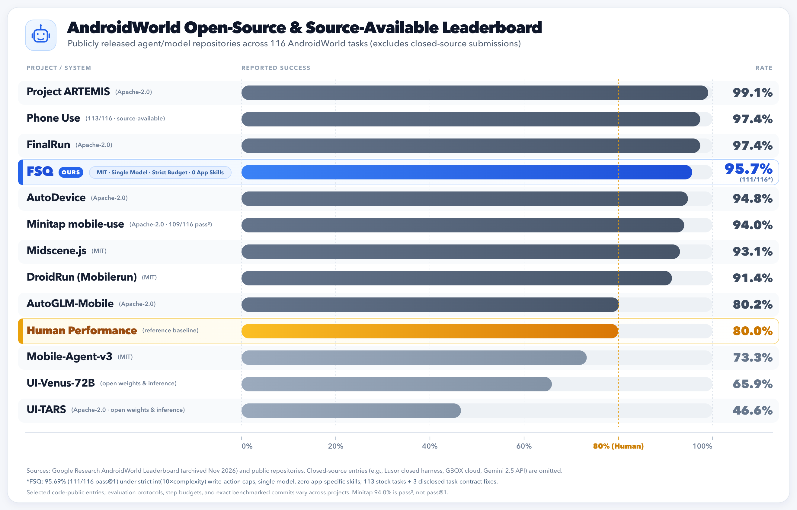
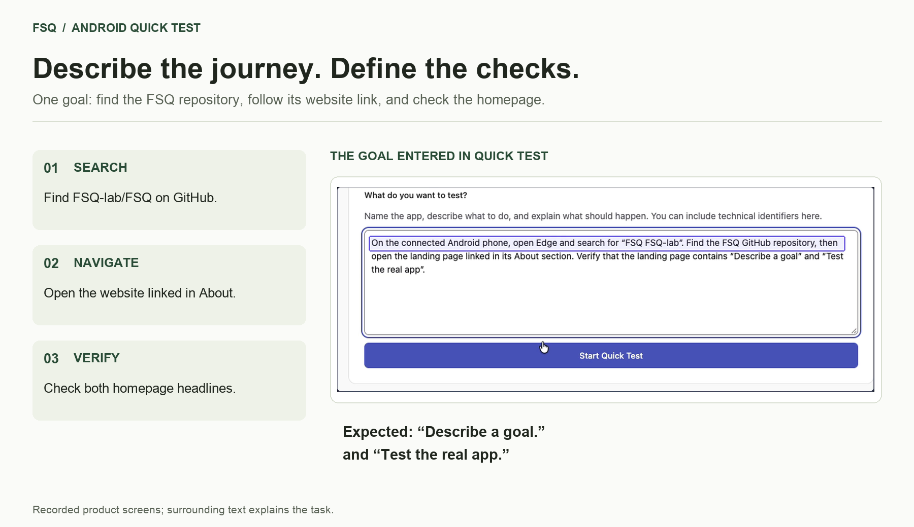
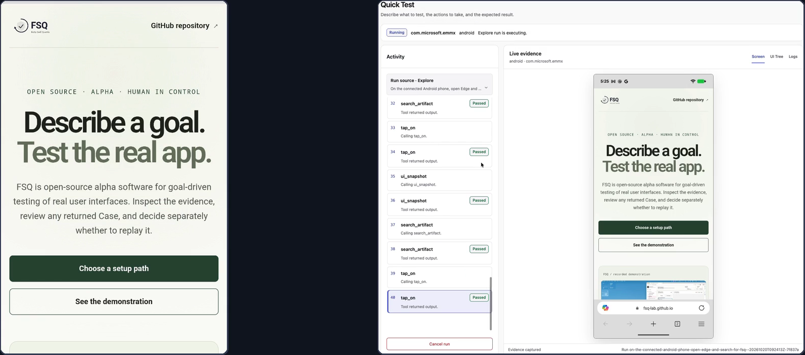
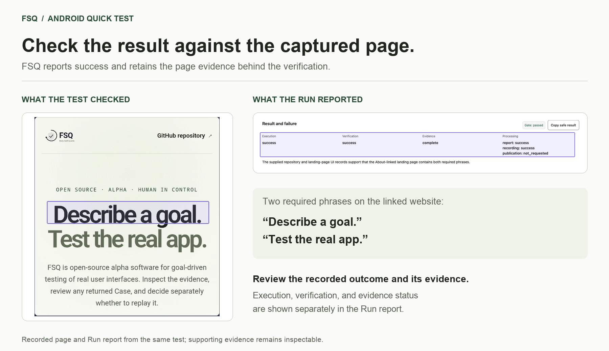

<p align="center">
  <picture>
    <source media="(prefers-color-scheme: dark)" srcset="docs/assets/logo-dark.svg">
    <source media="(prefers-color-scheme: light)" srcset="docs/assets/logo-light.svg">
    
  </picture>
</p>

<h3 align="center">描述测试目标，让 AI 测试真实应用。</h3>

<p align="center">用自然语言描述要做什么、应该发生什么。AI 操作真实应用并验证结果，FSQ 保留截图、操作和结果，供你检查。</p>

<p align="center">来自 <a href="https://github.com/FSQ-lab">FSQ Lab</a> 的开源项目。</p>

<p align="center">
  <a href="https://github.com/FSQ-lab/FSQ/actions/workflows/ci.yml"></a>
  <a href="https://www.python.org/downloads/"></a>
  <a href="LICENSE"></a>
  
  <a href="https://github.com/FSQ-lab/benchmarks/tree/main/androidworld"></a>
</p>

<p align="center">
  <a href="https://fsq-lab.github.io/FSQ/">官网</a> ·
  <a href="#快速开始">快速开始</a> ·
  <a href="#基准测评">基准测评</a> ·
  <a href="README.md">English</a> ·
  <a href="docs/getting-started.zh-CN.md">指南</a> ·
  <a href="CONTRIBUTING.md">参与贡献</a>
</p>

## 看一次完整测试

https://github.com/user-attachments/assets/3acfecf4-bf48-4c76-8245-2eeef0dedb1f

[在 YouTube 观看](https://youtu.be/f1sobvVHNg0) · [英文字幕](docs/media/quick-test.en.srt) · [媒体来源与审查状态](docs/media/quick-test-demo-provenance.md)

视频展示 Android 上的一次真实 Quick Test；下方可先用 Web 试用。两者环境和执行过程不同，搜索结果与测试结果不作保证。

## 基准测评

AndroidWorld **95.69%（111/116，pass@1）** · **Single Model · Strict Budget · 0 App Skills**。

<p align="center"><a href="frontend/website/public/benchmarks/androidworld-leaderboard.png"></a></p>

本图是代表性开源与源码公开项目的公开成绩快照，含人类参考，依据 Google Research 2026 年 11 月归档榜单及后续报告；
**不是含闭源提交的完整总榜，也不是官方同协议排名**。各项目协议、步数预算及分数与代码 commit 的绑定程度不同，不能按行序宣称受控名次。
Phone Use 源码公开但许可证未核实；UI-Venus/UI-TARS 仅核实公开权重和推理代码，未核实完整受测 AndroidWorld Harness。
许可标签不认证完整评测栈，调用商业模型 API 也不决定 Agent 代码是否开源。**Minitap 的 94.0% 是 pass³，非 pass@1。**

FSQ 使用 **113 项原版任务 + 3 项披露的任务契约修正、mode B**，并非原版 stock-strict 成绩；图中 95.7% 为圆整值，`111/116*` 对应这些条件。
单一模型指跨多次推理调用使用同一配置模型，0 App Skills 指不使用应用专属 Skill。冻结版本、预算计数和审计局限以 METHOD 为准。
[完整中文报告](https://github.com/FSQ-lab/benchmarks/blob/main/androidworld/README.zh-CN.md) · [METHOD](https://github.com/FSQ-lab/benchmarks/blob/main/androidworld/METHOD.md) · [对比来源与公开范围](frontend/website/public/benchmarks/leaderboard.json) · [完整证据](https://github.com/FSQ-lab/benchmarks/releases/tag/androidworld-2026-11-19)

## 快速开始

**Coding Agent 与 FSQ UI 是平等的两个入口。**需要 Python 3.11+、已配置的受支持 Provider、明确选择的模型和 [Web / Android / Windows / macOS 平台前置条件](docs/platform-prerequisites.md)。
凭据请在本地 FSQ 设置中私下输入，不要发到 Coding Agent 聊天。Quick Test 自动准备 `~/.fsq/quick-test/`，无需手动初始化项目 Workspace，不保存正式 Case，也不自动执行 Strict Replay。

### Coding Agent

按[安装与 Skill 配置指南](docs/getting-started.zh-CN.md#coding-agent)安装 FSQ 和项目 Skill，重新加载 Coding Agent；升级后也需更新 Skill 并重载。
然后请它“使用 FSQ Quick Test 测试下方目标”，选择 Web 和已确认的可用浏览器，并遵循已安装的 Skill。

### FSQ UI

```bash
python -m pip install --upgrade fsq-agent
fsq ui
```

在 **Settings** 配置 Provider 并明确选择模型，返回 **Quick Test**，选择 Web 和可用浏览器，粘贴下方目标并点击 **Start Quick Test**。
通过 **Open report** 检查结果与证据；详见 [FSQ UI 指南](docs/getting-started.zh-CN.md#fsq-ui)。

### 试一次完整的用户旅程

将以下完整目标复制到任一入口，只浏览公开页面：

```text
使用已选择的浏览器搜索 FSQ-lab/FSQ GitHub 仓库。打开该仓库，访问 About 区域中的官网链接，验证目标页面同时显示 “Describe a goal.” 和 “Test the real app.”，并结合捕获的页面证据报告结果。只浏览公开页面，不登录、不修改仓库内容、不提交表单。如果无法识别仓库或 About 官网链接，停止并报告阻碍。
```

运行后对照报告与页面证据；失败、无法确定或准备错误都不能当作检查通过。

## 从目标到证据

**描述旅程和检查点。**说明卡在真实目标输入截图周围添加解读，编辑说明不是产品 UI。



**观察真实执行。**Android 浏览器画面与 FSQ 操作时间线对应，截图和界面状态保留过程。



**对照证据检查结果。**说明卡并列真实页面与同次 Run 报告，展示两句标题和执行、验证、证据状态；它是本次记录，不保证其他运行成功。



## 需要时再进阶

- **审查证据：**检查截图、界面状态、事件和报告，定位实际行为与预期的差异。
- **管理 Case：**在 **FSQ Case Manager** 管理注册的 Workspace，显式创建或保存可用候选 Case、查看历史。Run 可能产生候选 Case，不保证生成成功。
- **另行重放：**审查返回的 Case 后，单独请求 Strict Replay；它会再次操作目标，需检查前置条件和副作用，Quick Test 不会自动重放。

## 一起完善 FSQ

如果有帮助，欢迎[点击 Star](https://github.com/FSQ-lab/FSQ)，或试用后[反馈体验](https://github.com/FSQ-lab/FSQ/issues/new/choose)；两者均非试用前提。
反馈请附版本、平台、脱敏目标、预期与实际结果及少量诊断信息；分享前移除凭据、个人数据、私有网址、路径和设备标识。安全问题使用 [Security](SECURITY.md) 渠道。

> [!IMPORTANT]
> FSQ 是供评估和贡献的 Alpha 软件，1.0 前公开接口可能变化。证据保存在本地，可能包含私有应用数据，分享前须审查，不要提交证据或凭据。
> AI 操作会将必要的 Provider 输入发送至你配置的 Provider。详见[支持与稳定性](docs/support-and-stability.md)。

## 文档

[CLI reference](docs/cli-reference.md) · [Case 格式](docs/case-format.md) · [Codex 高级兼容性](docs/codex-integration.md)

## 许可证

[MIT](LICENSE) — Copyright (c) Microsoft Corporation.
