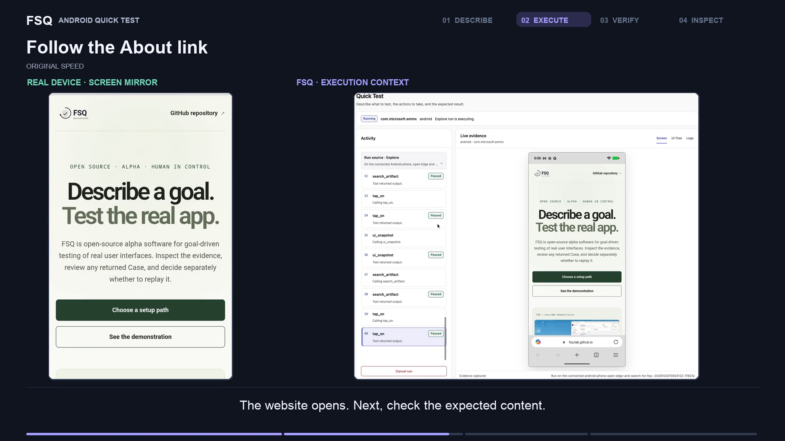

<p align="center">
  <picture>
    <source media="(prefers-color-scheme: dark)" srcset="docs/assets/logo-dark.svg">
    <source media="(prefers-color-scheme: light)" srcset="docs/assets/logo-light.svg">
    
  </picture>
</p>

<h3 align="center">描述测试目标，让 AI 测试真实应用。</h3>

<p align="center">用自然语言描述要做什么、应该发生什么。AI 操作真实应用并验证结果，FSQ 保留截图、操作和结果，供你检查。</p>

<p align="center">来自 <a href="https://github.com/FSQ-lab">FSQ Lab</a> 的开源项目。</p>

<p align="center">
  <a href="https://github.com/FSQ-lab/FSQ/actions/workflows/ci.yml"></a>
  <a href="https://www.python.org/downloads/"></a>
  <a href="LICENSE"></a>
  
</p>

<p align="center">
  <a href="https://fsq-lab.github.io/FSQ/">官网</a> ·
  <a href="#快速开始">快速开始</a> ·
  <a href="README.md">English</a> ·
  <a href="docs/getting-started.zh-CN.md">指南</a> ·
  <a href="CONTRIBUTING.md">参与贡献</a>
</p>

## 看一次完整测试

https://github.com/user-attachments/assets/3acfecf4-bf48-4c76-8245-2eeef0dedb1f

[](https://youtu.be/f1sobvVHNg0)

[在 YouTube 观看](https://youtu.be/f1sobvVHNg0) · [英文字幕](docs/media/quick-test.en.srt) · [媒体来源与审查状态](docs/media/quick-test-demo-provenance.md)

视频展示 Android 上的一次真实 Quick Test：搜索 FSQ 仓库，沿 About 官网链接访问主页，验证两句主标题。你可以先使用 Web 试用；不同平台的环境和执行过程不同，搜索结果和测试结果也可能变化。

## 从目标到证据

**描述完整旅程和检查点。** 找到 `FSQ-lab/FSQ`，进入 About 链接的官网，验证 `Describe a goal.` 和 `Test the real app.`。下图是在真实目标输入截图周围添加的说明，不是产品界面的一部分。


**观察 AI 操作真实应用。** Android 浏览器中的页面与 FSQ 操作时间线对应，截图和界面状态保留执行过程。


**对照证据检查结果。** 页面证据展示两句标题；同次 Run 报告分别显示执行成功、验证成功、证据完整。说明卡将真实页面与报告截图并列，便于独立阅读。


## 快速开始

选择 **Coding Agent** 或 **FSQ UI**，两条路径都从一次 Quick Test 和结果审查开始。需要 Python 3.11+、已配置的受支持 Provider 与明确选择的模型，以及[平台前置条件](docs/platform-prerequisites.md)。Provider 凭据请在本地 FSQ 设置中输入，不要发送到 Coding Agent 聊天。

Quick Test 自动准备 `~/.fsq/quick-test/`，无需手动初始化项目 Workspace，不保存正式 Case，也不执行 Strict Replay。

### Coding Agent

安装 FSQ Skill、重新加载后，请 Coding Agent 使用 FSQ Quick Test 执行下方完整目标。

<details>
<summary>展开：一次性安装与首次运行</summary>

在 Coding Agent 中打开你的项目，粘贴：

> FSQ 的官方项目地址是 https://github.com/FSQ-lab/FSQ。先确定准确打开的项目根目录。批量披露 Python、fsq 和 Skill 是否存在的只读检查，列出工作目录、命令、目的和影响。提出一次批准请求，只涵盖安装或升级 fsq-agent，以及在本项目运行一次 fsq init --agent skill；请求前列出准确命令及其对 Python 环境和项目文件的影响。只执行获准操作，验证 fsq，并报告 Skill 安装路径。此次设置不初始化 Workspace、不配置 Provider、不运行测试。最后让我重新加载 Coding Agent 或启动新 session，然后停止。

重新加载后，指定 Web 和可用的浏览器，发送“使用 FSQ Quick Test 测试下方目标”，附上完整目标。遵循已安装的 Skill；它会发现前置条件、询问未解决的决定，并报告实际进度和证据。包升级后需再次运行 `fsq init --agent skill` 并重新加载，才能更新复制到项目的 Skill。

</details>

[打开 Coding Agent 详细指南](docs/getting-started.zh-CN.md#coding-agent)

### FSQ UI

安装并打开本地 UI，选择 **Quick Test**，粘贴相同目标。

<details>
<summary>展开：安装与开始 Quick Test</summary>

```bash
python -m pip install --upgrade fsq-agent
fsq ui
```

1. 在 **Settings** 配置受支持的 Provider，并明确选择模型。
2. 返回 **Quick Test**，选择 Web 和可用浏览器，粘贴下方目标。
3. 点击 **Start Quick Test**。FSQ 解析应用并验证目标和环境后开始测试；意图不明确、目标零匹配或多匹配、准备失败会终止请求，不补问。
4. 通过 **Open report** 检查结果与证据。目标可运行不等于模型一定理解正确。

</details>

[打开 FSQ UI 详细指南](docs/getting-started.zh-CN.md#fsq-ui)

### 试一次完整的用户旅程

Web 是便于开始的试用选项；视频录制的是 Android。选择浏览器后，将以下完整目标复制到任一入口：

```text
使用已选择的浏览器搜索 FSQ-lab/FSQ GitHub 仓库。打开该仓库，访问 About 区域中的官网链接，验证目标页面同时显示 “Describe a goal.” 和 “Test the real app.”，并结合捕获的页面证据报告结果。只浏览公开页面，不登录、不修改仓库内容、不提交表单。如果无法识别仓库或 About 官网链接，停止并报告阻碍。
```

运行后，检查报告中的结果和页面证据。失败、无法确定或准备错误应按实际结果处理，不能当作检查已通过。

## 需要时再进阶

- **审查执行证据：**检查截图、界面状态、事件和报告，定位实际行为与预期的差异。
- **管理可复用 Case：**在 **FSQ Case Manager** 中管理注册的 Workspace、显式创建或保存可用的候选 Case，并查看运行历史。Run 可能产生 Case，生成并不保证成功。
- **另行选择确定性重放：**原样审查返回的 Case 后，再单独请求 Strict Replay。重放会再次操作目标，需检查前置条件与副作用；Quick Test 不会自动重放。

FSQ 支持 Web、Android、Windows 和 macOS 目标，请查看[平台前置条件](docs/platform-prerequisites.md)。

## 一起完善 FSQ

如果 FSQ 对你有帮助，欢迎[前往 GitHub 仓库点击 Star](https://github.com/FSQ-lab/FSQ)，让更多人发现它。试用后，欢迎[反馈体验](https://github.com/FSQ-lab/FSQ/issues/new/choose)：什么有效、哪里卡住、下一步想测试什么。

反馈请提供 FSQ 版本、平台、脱敏目标、预期与实际结果，以及审查后的少量诊断信息。移除凭据、个人数据、私有网址、路径和设备标识，再分享截图或日志。安全问题请使用 [Security](SECURITY.md) 中的渠道。

> [!IMPORTANT]
> FSQ 是用于评估和贡献的 Alpha 软件。证据保存在本地，可能包含私有应用数据，分享前请审查，不要提交证据或凭据。AI 操作会将必要的 Provider 输入发送到你配置的 Provider。公开接口在 1.0 前可能变化，请阅读[支持与稳定性](docs/support-and-stability.md)。

## 文档

- [中文快速开始](docs/getting-started.zh-CN.md)
- [Getting started](docs/getting-started.md)
- [CLI reference](docs/cli-reference.md)
- [FSQ Case format](docs/case-format.md)
- [Codex 高级兼容性](docs/codex-integration.md)
- [平台前置条件](docs/platform-prerequisites.md)
- [参与贡献](CONTRIBUTING.md)

由 [FSQ Lab](https://github.com/FSQ-lab) 与社区共同打造，感谢[所有贡献者](https://github.com/FSQ-lab/FSQ/graphs/contributors)。

## 许可证

[MIT](LICENSE) — Copyright (c) Microsoft Corporation.
