# fsq-agent Project Specification

Root `SPEC.md` is the project-level specification and module navigation source of truth. Each module also owns a module-level `SPEC.md`.

## Project Specification Ownership

Root `SPEC.md` and module `SPEC.md` files are the current factual baseline for implementation. They describe present behavior, public contracts, module ownership, dependency direction, configuration surface, error semantics, architecture level, and implementation invariants.

## Tool And Capability Execution

fsq-agent separates dynamic-only helper tools from recordable execution capabilities.

- AgentTools are SDK-neutral helper tools used only during dynamic execution through `agent_engine`. They include scoped file reads/writes and bounded run-artifact search/slice helpers. AgentTools are not strict replay capabilities, are not registered in FSQ capability registries, and are never recorded into generated strict YAML.
- CommonTools are recordable platform-default execution capabilities inherited by every active platform. The active CommonTool is `wait_ms`/`waitMs`. Runtime-secret credential input is represented on text-entry PlatformTools with `textType: runtimeSecret` and is resolved by execution core before driver invocation, not by an LLM-facing secret-fetch tool.
- PlatformTools are recordable active-platform capabilities. They include concrete backend driver actions, including backend-owned assertions such as `assert_with_ai`.

All recordable execution behavior is declared through decorator-driven capability metadata. The neutral `capabilities` module owns shared declaration decorators, catalog-backed platform validation, and reflection/discovery helpers that produce `models.CapabilityDefinition` records for CommonTools and PlatformTools. The capability registry is the source of truth for canonical names, replay aliases from `ReplayPolicy(kind="fsq_command")`, parameter schemas, tool family, replay policy, sensitivity, step kind, platform/backend ownership, and provenance. LLM-facing CommonTool and PlatformTool parameter schemas are generated from shared Pydantic parameter models and include concise field descriptions plus model-level guidance for cross-field argument rules such as target-or-locator and runtime-secret text-entry contracts. Live capability executor kinds are `common` for inherited CommonTools and `driver` for driver-backed PlatformTools; `harness` is not a live capability executor kind. Capability metadata does not own per-tool engine schema strictness or default screenshot capture policy; active engine capability tools use strict JSON schema by default. Methods that are unfinished or should not be exposed to the LLM must not be decorated as active capabilities.

Decorator unification is a declaration-layer concern, not an AgentTool merge. AgentTools remain dynamic-only helper behavior owned by `tools`; CommonTool and PlatformTool capabilities are owned by `core`. CommonTool bodies live in platform tool providers, while backend-specific PlatformTool bodies live on concrete backend drivers. Concrete harness classes such as `AndroidHarness` and `WebHarness` remain runner-facing runtime gateways and services, but they must not own individual tool bodies such as `assert_with_ai`.

`StepRunner` is the common execution manager for CommonTool and PlatformTool capabilities. It looks up the capability registry, validates params, resolves runtime-secret text input references, applies step-kind evidence capture, post-action delay, and sensitivity policy, emits structured safe events, and invokes recordable capabilities through `HarnessInterface.invoke_action(step, context)`. Harness implementations route CommonTools to inherited platform tool providers and driver-backed PlatformTools to concrete backend drivers while supplying runtime services such as context, artifact capture, evaluator injection, driver access, settings, and error classification. Default automatic evidence capture is derived from the resolved capability (`executor_kind == "driver"`) plus `ExecutableStep.kind`: driver `action` and `setup` steps capture finalize `screenshot` only, driver `assertion` and `teardown` steps capture prepare `screenshot` only, and `observation` steps, `diagnostic` steps, and inherited CommonTool steps (`executor_kind == "common"`, such as `wait_ms`) do not receive automatic screenshot capture. Runner does not perform automatic `ui_snapshot` capture; explicit observation capabilities (`ui_snapshot`/`uiTree`/`uiSnapshot`) remain available on demand. For every capability, the effective post-action delay resolves from `CapabilityDefinition.post_action_delay_seconds` when set, otherwise `0.0` for CommonTools (`execution.post_action_delay_seconds.common` when applicable) and for non-mutating PlatformTool step kinds (`observation`, `assertion`, `diagnostic`, `teardown`), and configured `execution.post_action_delay_seconds.platform` for driver `action` and `setup` steps. A positive delay is execution timing only, occurs after invoke and before finalize/after-action evidence capture, and must not create synthetic `waitMs` commands, evidence steps, replay commands, or action results. Executable paths must not branch on names such as `waitMs`, `wait_ms`, Android command names, Web command names, or desktop command names.

`StepRunner` accepts `capture_action_before: bool = False` (forwarded from `RunExecutionContext.capture_action_before`, default `False`); by default both dynamic execution and Strict omit redundant action prepare capture while retaining `action`/`setup` finalize screenshot storyboards, `assertion`/`teardown` prepare screenshots, validation, hooks, and failure precedence. By default, model-facing history retains up to 30 compact tool outputs within per-output and cumulative limits of 60,000 and 180,000 characters, without changing original execution events or durable evidence.

Capability registry bootstrap is platform-selected. Entry layers register the active platform's inherited CommonTool capabilities plus only the configured platform's PlatformTool capability set. Android and Web PlatformTools must not be registered together in the default runtime registry, so each platform can expose native canonical names and `fsq_command` replay aliases without cross-platform ambiguity. AgentTools are exposed only to dynamic agents through `agent_engine` and are excluded from strict replay registries.

All five active platforms (`android`, `ios`, `macos`, `windows`, and `web`) use only `assert_with_ai` / `assertWithAI` for visual assertions and retain an assertion-only contract. Separate `inspect_with_ai` / `inspectWithAI` is read-only: `extract` reads pixel-only visual content on all five platforms. Android, iOS, and macOS `locate` return pointer candidates only with SDK-validated mapping, including the single-main-display requirement on macOS; Windows `locate` returns pointer candidates only when the bound `HWND` capture frame has verified 1:1 physical pixel congruence (`GetWindowRect` dimensions equal the single-frame `PrintWindow` PNG dimensions under Per-Monitor v2 DPI awareness on an unchanged bound window within virtual-screen pointer bounds). Unsupported topology, unverified Windows window/DPI geometry, and Web return `pointer_mapping_unavailable`; FSQ never guesses pointer coordinates. Inspection never drives UI, substitutes for an assertion verdict, or enters deterministic Case recording. On Android, iOS, and macOS the SDK owns AI visual acquisition and pointer mapping without a native screenshot fallback, and `sample_color` is a deterministic SDK observation without a Provider call or upload gate; on Windows, `sample_color` is a deterministic local driver observation over the bound-window PNG frame (supporting `coordinate_space="pointer"` when 1:1 window-to-screen mapping is verified and `coordinate_space="image"` directly) without a Provider call or upload gate. Windows and Web use driver-owned single-frame capture. FSQ owns model adaptation, per-frame authorization, budgets, safe errors, and Run-contained same-frame evidence on every platform.

Every platform visual assertion verdict is tri-state: `passed`, `failed`, or `inconclusive`. Only a valid negative evaluation or structured same-target deterministic counterevidence establishes `failed`; operational errors, occluded/blank/unverifiable frames, unauthorized uploads, and absent providers establish unverified `inconclusive`, represented by Runner `status="incomplete"` without an assertion-failure category. This state survives tool output, sequencing, verification, result freeze, reports, and replay; neither optional assertions nor model success can silently clear it. Cancellation remains cancellation. Existing independent execution/evidence/cleanup failure precedence is preserved.

Each visual assertion across all five platforms uses at most one fresh screenshot, shared with the step's prepare evidence capture after privacy approval (falling back to a single invocation capture only when invoked standalone without prepared artifacts), and at most one tool-free model request. The host capture envelope is Run-local, does not prove display identity or device capture time, and fixes `pointer_mapping_state="unverified"`. No screenshot, digest lookup, recorded verdict, or late model response is reused across steps or Runs. Authored replay without a ready authorized provider remains a recognized incomplete assertion (`provider_unavailable`) rather than an unsupported action, startup failure, or fabricated pass.

## Case Creation And Testing

The public Case workflows are `fsq case create`, `fsq case test`, and static `fsq case format`. Case creation accepts a natural-language Goal, uses AI during real testing, and may write a Run-local candidate `*.fsq.yaml`. Case testing accepts an existing `*.fsq.yaml`, executes it exactly once through the deterministic path, and preserves the source file. With `--suggest`, a separate post-execution AI analysis may produce Run-local suggestions and a candidate Case from the parsed source and persisted execution facts; that analysis has no UI-action capabilities and cannot change the completed execution result. Without `--suggest`, testing performs no AI-driven Case analysis or modification. Adapters invoke these workflows through the shared Application package.

`*.fsq.yaml` is canonical. `*.codex.yaml` may be accepted for one deprecation cycle with a structured warning. `*.intent.yaml` and `fsq.test-intent/v1` are unsupported. Top-level public execution commands named `test`, `replay`, or `run` are not part of the target CLI.

## Recorded Case Artifacts

AI-participating Case operations may record a replayable trace as a Run-local candidate `*.fsq.yaml`. The agent persists normalized capability events and Execution coordinates conversion of replayable non-observation results according to `ReplayPolicy` metadata. Generated Goal Cases use a stable Case name and normalized Goal description, identically for valid and draft recordings. Explicit Case names take precedence; otherwise Execution derives a deterministic name from platform and normalized Goal. Run provenance, recording status, draft state, and warnings belong to Run-local recording metadata rather than generated Case YAML. Generated Cases never mutate source Cases, and secrets are never persisted. CLI Goal-based Case creation publishes validated recordings under the stable name, while Quick Test CLI and Control Plane Explore keep recordings Run-local. Control Plane supports explicit save under a chosen name; Quick Test CLI has no save/publication option. Publication and save reuse identical destination bytes without writing and reject differing existing contents without replacement; the Run-local candidate remains available. Suggestion-enabled existing-Case testing never publishes into `cases.dir`.

Recorded strict cases may contain runtime-secret text input references using `textType: runtimeSecret` and `waitMs` replay aliases. Strict execution bootstraps the active platform capability registry before YAML parsing, treats missing `textType` on text-entry commands as literal text for case compatibility, resolves runtime-secret text values in memory before external text-entry actions begin, and resolves `waitMs` through the registry to the inherited `wait_ms` CommonTool capability.

Recorded Web lifecycle commands are ordinary replayable capability results when the dynamic run actually executed `startBrowser` or `closeBrowser`. The recorder must not invent browser lifecycle commands as cleanup or setup guesses.

For Goal-based Case creation, completion of the Dynamic Agent main execution appends one `dynamic_agent_token_usage` event to the Run-local `events.jsonl` when neutral engine usage measurements are available. The event reports only the selected backend's measured aggregated usage for that main execution and excludes pre-plan, final verification, AI assertions, suggestions, readiness, authentication, and metadata requests. Token counts are never estimated, and this usage event does not change `run.json`.

FSQ Case metadata may declare optional deterministic lifecycle hooks through `onCaseStart` and `onCaseComplete`; platform config may declare reusable hooks through `caseLifecycle`. `runCase` executes another `*.fsq.yaml` using the same contained Case path policy, and recursive chains fail before infinite execution. Application coordinates lifecycle execution through FSQ and Core authorities; adapters do not own lifecycle semantics.

## Deterministic Case Formatting

`case_dsl` owns shared static validation, model-aware normalization, and deterministic YAML serialization used directly by Case recording, suggestion candidates, saved recordings, and Application formatting. CLI is a transport entry to the same Python contracts, never an internal subprocess dependency. Equal stable metadata, configuration, ordered actions, and effective parameters produce byte-identical Cases; genuine behavioral differences remain visible. Ordinary formatting preserves existing identity and user metadata and does not perform historical migration.

`fsq case format PATH [--check | --diff | --write] [--json]` is non-interactive and defaults to read-only checking. It validates before formatting or writing, needs no registered Workspace or Provider, and never executes actions or resolves credentials. Static validation checks only the named Case and hook syntax; cross-file lifecycle and runtime preflight remain execution responsibilities. Application owns file orchestration; Case DSL owns content rules; adapters own output and exit mapping.

## Dynamic LLM Pre-Plan and Goal Verification

Goal-based Case creation uses pre-plan as the input-understanding boundary before external UI actions begin. The pre-planner receives complete configured skills that load successfully, optional project/page knowledge, and the active capability summary. It produces ordered `key_actions` and one `verification_goal` before external UI actions.

Generated execution key actions retain their associated nonempty planner notes without extra inference or arbitrary truncation; explicit caller-supplied action strings remain unchanged. Execution guidance preserves requested complete file identity and terminal-state constraints, uses supplied write budgets without changing enforcement, and establishes requested collection coverage before claiming completion. Generated guidance does not create additional final verification goals.

An authorized browsing, inspection, or exploration request may use an observable flow-delivery goal: perform the requested scope and return truthful evidence-grounded observations without unauthorized effects. A structurally valid pre-plan with blank verification text uses a built-in request-grounded delivery criterion rather than rejecting a legitimate open-ended request. This fallback preserves every explicit outcome, exact value, scope, output-format, and terminal-state constraint; malformed model output remains a technical planning failure. Final verification does not add unrequested acceptance conditions or relax explicit exact-answer or state-change requirements.

For questions, counts, calculations, and requested lists, the main structured summary delivers the best answer supported by observed evidence first, in the requested format and units. Uncertainty and incomplete coverage remain in structured claims, errors, or evidence notes rather than replacing an available answer with a disclaimer; unsupported answers and unsupported success claims remain forbidden. Main execution reads complete source fields and computes selections before writing, then reads back and corrects goal-relevant saved state before returning while its Harness is still open. Valid optional write-budget receipts guide economical actions and goal-required completion reserves only; absent, malformed, or failed hooks add no write restriction, synthetic charge, or early termination. After `run_task` and Harness cleanup, final verification uses a tools-free model call by default; `agent_runtime.verification_enabled: false` skips that call and uses local runner-result and evidence reconciliation. Verification never performs repair writes.

Existing-Case testing parses the Case through FSQ rather than treating YAML as untyped planning text. Suggestion-enabled testing first completes the same single deterministic execution as ordinary Case testing, then gives the parsed Case and bounded persisted execution facts to a read-only AI analysis that cannot invoke Harness, Driver, Core capabilities, or other UI actions. The analysis preserves the authoritative execution status and facts, keeps source steps immutable, and writes suggestions and any candidate Case only inside that Run directory.

`DynamicExecutionService` owns dynamic Run allocation, source snapshots, authoritative evidence context, frozen execution conclusions, derived processing, and metadata transitions. It supplies a Models-owned `RunExecutionContext` and shared evidence sink to `FsqAgent.run_in_context`; Agent performs planning, execution, verification, and business event emission through neutral runtimes and returns `DynamicAgentOutcome` without importing Execution, allocating/updating Run metadata, or generating reports. Execution applies explicitly requested evidence requirements and freezes execution and verification facts before report generation and optional recording, then finalizes processing and cancellation/error paths without creating another Run. Processing failures cannot overwrite the frozen execution conclusion.

## Model And Agent Boundary

`agent_engine` owns independently reusable model/provider/agent-execution protocols and neutral input, output, tool, event, filter, and error contracts. Its private backends use the pinned OpenAI Python client for Responses requests and the pinned Google GenAI Python client for Gemini Developer API Interactions requests. Concrete backend objects, vendor message shapes, third-party exceptions, and concrete constructor injection do not cross into FSQ business code.

All inference paths use this boundary for OpenAI, Azure OpenAI, DeepSeek, Google Gemini, Kimi, and GitHub Copilot: pre-plan, main execution, and verification call `AgentEngine.run`; visual assertions, connection testing, Case suggestions, and Quick Test intent analysis call tool-free `Model.complete`. A sole local tool dispatcher and continuation loop is shared across backends; each private backend owns round trips, protocol conversion, and opaque history, not another execution loop. Model-paired engine selection remains inside `agent_engine`. Direct requests do not enter the agent loop, and the loop does not call public tool-free `Model.complete` or add semantic retries.

Both neutral request types carry validated `reasoning_effort` with values `low`, `mid`, or `high` and an omitted-field default of `mid`. Every backend request, including continuation, explicitly sends the mapped native effort. Coding Agent and AI Services forward the resolved platform effort across business inference paths; connection testing independently requests `low`. Agent Engine owns private numeric-version mappings, while Providers owns compatible discovery filters and identifies Azure's opaque deployment-name context without looking up an underlying model. Invalid effort fails before inference or tool effects; unsupported native settings follow safe error handling without effort negotiation, hidden model replacement, or a repair request.

Both engine entry points share private response validation and caller-owned output-contract parsing inside `agent_engine`. Optional `ModelRequest.output` and `ModelResult.parsed_output` carry the same generic output type through neutral model and Provider session calls while retaining existing text, usage, completion information, and positional argument order. A constrained single call sends the backend-native schema and returns the extracted original text plus the parser's value only after protocol validation and parsing succeed. Unconstrained calls, including connection testing, retain plain-text behavior without a JSON-schema format. The engine does not depend on FSQ business models or Pydantic, and Providers does not interpret schemas or parse results.

Kimi Agent requests containing both function tools and an output contract separate tool execution from structured finalization. Tool-capable turns omit the final-output schema; after execution produces a nonempty message without pending tool calls, one tool-free turn formats the retained conversation using the original output contract. Both phases use the same local continuation loop, model, effort, cancellation scope, context filtering, request budget, and measured usage. Finalization cannot invoke tools, restart execution, or repair a rejected structured result. This protocol policy belongs to `agent_engine` and does not change public configuration or other Providers' request behavior. Structured summaries remain model claims: only actual capability evidence establishes executed actions, and no-action Runs retain the existing inconclusive policy.

Known incomplete, failed, or refused responses produce safe neutral `EngineError` failures rather than usable partial results. Invalid constrained output is a generation error, not a negative business verdict. Visual assertions across Android, iOS, macOS, Windows, and Web uniformly expose `outcome=passed|failed|inconclusive`. Case suggestion failures retain completed Run/report truth and Application-owned candidate validation/publication. Business consumers handle neutral errors through their operation-result mappings without duplicating provider response-status checks or reparsing text. Only Agent execution owns tool continuation and turn budgets: pending tools take precedence during execution, absent required final text may continue within the budget, and nonempty invalid final candidates fail. Kimi's separate finalization turn fails on absent or invalid text or unexpected function calls without dispatch or a repair request; its execution-phase message is not parsed as the final candidate. Constrained single calls fail on absent or invalid final text without an extra inference or repair loop.

An optional caller-owned `AgentRequest.final_turn_instructions` enables a structured closing opportunity within the existing turn limit. After at least one execution turn, the shared engine uses the last available logical turn with the original output contract, retained conversation, and no advertised tools; it cannot dispatch returned calls or resume execution. FSQ supplies evidence-grounded answer-delivery policy through its Agent-owned facade. This closing turn is part of main execution before Harness cleanup, not another verifier or inference loop; hard exhaustion and invalid output retain their existing safe failure semantics.

The supported engine surface consists of bound function tools, caller-owned output contracts, streaming and non-streaming execution, context filtering, and safe tracing export. Runtime and normal test dependencies do not include `openai-agents`; no SDK fallback, complete SDK copy, or runtime reference-checkout dependency is used.

Gemini direct and Agent inference explicitly disable Interactions storage with `store=false` and use complete local continuation without server-managed conversation ids. Required opaque provider state stays private; context filtering exposes only neutral tool-output entries. The actual pinned clients over controlled HTTP/SSE transport verify protocol compatibility, built-in FSQ schemas, and all inference paths; SDK doubles alone are not compatibility evidence.

`providers` owns FSQ supplier authentication, token refresh/cache policy, model discovery/filtering, configured access, and connection testing. It supplies explicit connection values and owns neutral provider scopes, not concrete inference clients. `ai_services` owns assertion, suggestion, and Quick Test intent prompts, input preparation, private model-facing schemas and parsers, conversion of parsed objects to public business results, factories, and suggestion readiness. It does not discover installed applications or authorize execution. `adapters.coding_agent` binds FSQ policies and tools to neutral execution and maps events/results back into existing business contracts. Core receives evaluators through its existing injected protocol.

The engine has no dependency on FSQ business packages or storage. Public inference contracts do not include mandatory authentication methods, GPT-specific high-level model settings, server-managed conversation identifiers, or vendor transcript passthrough. FSQ business runtime names are SDK-neutral: the Coding Agent factory returns the public protocol implemented by `DefaultCodingAgentRuntime`, and Config exposes `Settings.agent_runtime` using Models-owned `AgentRuntimeSettings` and `AgentPromptConfig`. Genuine OpenAI client, backend, dependency, supplier, endpoint, authentication-file, and tracing names retain their actual identities.

## Quick Test And Case Manager

`fsq quick-test` provides standalone CLI context discovery and goal-based execution without starting Control Plane. `fsq ui` serves one Control Plane application with two browser entry choices: Quick Test for goal-based exploration without Workspace setup, and FSQ Case Manager for the complete Workspace, Case, Test Runner, history, and Provider workflows. Existing Run report links open Case Manager reports directly. CLI and browser Quick Test share Application preparation/execution orchestration over the same global Provider settings, platform presets, dynamic Execution service, evidence, and report contracts. CLI requires no HTTP service or registered project Workspace and introduces no second execution engine.

Quick Test supports Android, Web, Windows, and macOS under their existing host/runtime restrictions. Callers explicitly select a platform and applicable device/browser, then supply one natural-language goal. CLI passes the selection through `--target-id`; desktop application identity comes from the goal. Android alone permits automatic selection of the sole available device when no selection or explicit clearing intent exists, under the selection lifecycle in `frontend/control-plane/SPEC.md`; this never replaces an existing device identity or bypasses validation or browser Start. Workspace and Explore/Strict selection are absent; Quick Test is always Explore. Its browser sidebar contains Quick Test and bottom Settings only. Strict Replay and Case management remain in Case Manager.

Application coordinates tool-free intent analysis through AI Services and concrete target validation through Environments before normal execution preflight. The model interprets the application named in the current prompt and may infer its native package, bundle, or executable identity. Web accepts either a valid explicit HTTP(S) starting address or a clear search/discovery goal that does not supply an address. The prompt must provide enough intent to infer test actions and a checkable outcome; the website address to be discovered is a result, not a required input. Input sufficiency is semantic, not a minimum character count. Unresolved or ambiguous intent, zero or multiple matches within a required target lookup, invalid supplied addresses, discovery failure, and model failure terminate the request with distinct safe errors before application launch or UI actions. There is no clarification dialogue, candidate picker, automatic target substitution, or reuse of the last application's identity to complete an ambiguous prompt.

Quick Test uses one AI Services-owned deterministic Web-address parser for supplied-address extraction, explicit model-reference provenance, and the exact frozen starting address. Explicit quotation, inline-code, angle-bracket, and Markdown-link boundaries preserve the complete enclosed HTTP(S) address without trimming legitimate terminal punctuation, path/query/fragment characters, balanced parentheses, or IPv6 brackets and ports. Unquoted natural-language boundaries recognize adjacent Chinese sentence punctuation and closing quotation/bracket characters without absorbing following prose. ASCII punctuation within an address's path, query, or fragment remains address data rather than being stripped wholesale. Ambiguous or malformed boundaries fail with a safe address error instead of a shortened address, arbitrary candidate, or address-free search fallback. The parsed starting address retains its original case, escapes, Unicode address data when explicitly delimited, port, path, query, and fragment; no decoding, normalization, completion, or substitution changes its identity. Prefix/embedded-address matches and model references that differ from a complete supplied address are rejected. These rules apply identically through CLI and browser preparation; no inference, Workspace mutation, or UI action occurs to repair syntactically invalid input.

Web Quick Test accepts an optional explicit starting URL through the standalone CLI. That URL is validated as an entire HTTP(S) address and frozen unchanged, independently of natural-language punctuation in the goal. The model interprets test actions and the expected outcome rather than selecting or reconstructing the supplied starting address. Omitting the explicit URL retains existing goal-based address identification and address-free search behavior. The browser Quick Test request and its single goal input remain compatible and do not require another field. Bare addresses followed immediately by a Chinese fullwidth parenthetical explanation, such as `https://example.com（不得替换为其他站点）`, are separated from the explanation without rewriting either the URL or the complete goal.

Chinese-facing goals support paired fullwidth parentheses/square brackets, Chinese brackets/book-title marks/quotation marks, fullwidth quotes, and complete Markdown strong-emphasis wrappers around an address. The same Chinese opening marks, ellipsis, and em dash delimit prose immediately after a bare address, including the form `https://example.com（不得替换为其他站点）`; they are not appended to its host/path. A recognized address label such as `网址:` or `URL:` may immediately precede a reference without whitespace. Labels and wrappers establish boundaries only: they do not relax complete-reference provenance, permit malformed schemes, normalize fullwidth URL data into ASCII, or alter explicitly enclosed address characters.

URL-free Web search uses the selected browser and its existing blank-page startup and absolute navigation capabilities. Application clears the current and frozen Web base URL, without inventing a user-supplied address, guessing the website to be discovered, configuring a search provider, or introducing another search service. The existing Agent plans and executes the search route, respecting any route or site named in the goal. A supplied malformed or unsupported navigation address is an error, not permission to use this address-free path.

These URL-free Quick Test searches carry an explicit execution evidence requirement. Before freezing a successful result, Execution requires actual current-Run Web capability activity and usable browser observations of a nonblank HTTP(S) page. Model text, a claimed URL, synthetic planning/verifier steps, and blank-browser startup alone do not satisfy it. Missing supporting browser facts prevent a success conclusion even when the model reports success. This is a necessary evidence gate, not proof that a discovered site is official; goal verification still evaluates the observed page/link sources. Other dynamic tasks, explicit-URL Quick Tests, and Strict Replay retain their existing completion policies.

Platform checks establish that the explicit or model-inferred target exists and satisfies runtime prerequisites. They do not establish that the model understood the intended application correctly, and Quick Test does not enumerate every same-named installed application to prove semantic uniqueness. An inferred native identity can scope concrete lookup without a separate local display-name-to-identity mapping. Model output alone never establishes installation, readiness, or test success; actual lookup and preflight remain mandatory.

All Quick Tests for one user configuration root use the registered `quick-test` Workspace at its `quick-test/` child, normally `~/.fsq/quick-test/`. Application prepares only the selected platform on a valid start through existing Config persistence, verifies the exact name/root pair, and preserves other Workspaces, Provider state, private env, Cases, and history. No placeholder application configuration or alternate-root fallback exists. Each execution freezes its validated target and settings. The dedicated Workspace remains visible to Case Manager.

The two browser entries share the existing single-active-task boundary per Control Plane service, including Quick Test preparation. A standalone CLI process executes one request; the service-local reservation does not provide mutual exclusion between CLI processes or between CLI and Control Plane. Browser navigation, refresh, or closure does not cancel a server task; returning to Quick Test recovers its active task without replaying the start request. Service restart does not resume execution. Quick Test presents truthful current results, evidence, and persistent report references, but no Save Case action or separate history-management page. Run-local recordings retain existing Explore semantics and are not automatically published.

## Runtime Configuration Defaults

Except for Quick Test commands, user-level Provider commands, static Case formatting, and creation of an unregistered Workspace, the exact CLI current directory is a registered workspace root using the canonical `.fsq/config/config.<platform>.yaml`, `.fsq/runs/<platform>/`, `cases/<platform>/`, and `knowledge/<platform>/` layout. CLI does not create or accept `.fsq-agent-workspace` markers, search parents, or auto-initialize project Workspaces. Quick Test resolves only its dedicated registered root. For a new name, `fsq init` treats the current directory as the selected directory: an empty directory becomes the Workspace root, while a non-empty directory receives a new `<selected-directory>/<workspace-name>` child. For an existing registered name, initialization uses its stored root independently of the process current directory. Workspace-scoped CLI commands require the exact registered root, and platform execution operations require the selected platform. Control Plane uses the same Application and Config-owned root-selection and registry rules while retaining explicit browser workspace selection independent of its startup directory.

LLM access has no default provider or fixed model. Config resolves the explicitly selected OpenAI, Azure OpenAI, DeepSeek, Google Gemini, Kimi, or GitHub Copilot provider, model, and credentials from the user-level configuration/auth store under `~/.fsq`, not workspace YAML, `.env`, or process provider environment variables. OpenAI uses only the official `https://api.openai.com/v1/` endpoint and the Responses inference path. Its configuration selects from authenticated, conservatively filtered GPT-5-or-later model discovery; Application revalidates selection before Config activates the single complete Provider. Discovery and configuration do not send model inference, and the explicit saved-configuration connection test is separate. Provider replacement preserves workspace registry state and removes inactive credentials only after activation succeeds. Tracing is requested by default but exports only with a configured OpenAI export key, with sensitive tracing disabled. Repository-owned platform YAML presets are package-owned files under `fsq_agent/config/`; the sibling `config.example.yaml` is reference-only. Reusable preset skills are tracked package resources under `fsq_agent/resources/skills/`. Source checkouts and installed distributions resolve the same package-owned preset and skill files. Workspace platform configuration owns local target identity and private runtime-secret values. A Web target always names a browser channel and may omit its executable path so Application can discover exactly one compatible host executable before Driver readiness or workspace mutation.

DeepSeek uses `deepseek`, the fixed `https://api.deepseek.com/` endpoint, an API key stored only in `~/.fsq/auth/deepseek.json`, and the existing OpenAI-compatible Responses inference path. Control Plane and CLI share authenticated candidate-key discovery and selected-model activation through Application. Eligible model ids are the stable `deepseek-flash` alias, exact versioned Flash ids at version 4.1 or later, and exact versioned Pro ids at version 4.0 or later; matching later versions have no upper bound, while extra suffixes and other families are excluded. This family/version policy is selection eligibility rather than a capability probe. Discovery sends no inference, Application revalidates exact membership before activation, and runtime incompatibility fails without provider fallback, model substitution, or image-specific retry.

Google Gemini uses `google_gemini`, the fixed `https://generativelanguage.googleapis.com/v1beta/` Developer API endpoint, and an API key stored only in `~/.fsq/auth/google-gemini.json`. Control Plane and CLI share candidate-key discovery and selected-model activation through Application. Discovery completes all bounded pages before offering models; only generation-capable stable exact Flash ids at version 3.0 or later and Pro ids at version 3.1 or later are eligible. Preview, latest, experimental, Lite, and specialized variants are excluded; Vertex AI, ADC, service accounts, custom endpoints, and Provider fallback are unsupported. Configuration requires explicit model selection and preserves version-3 user state and workspace registry ownership. Live-service verification is separate from isolated deterministic tests and reports whether discovery, connection testing, Explore, and AI visual assertions were actually exercised.

The local setup entry is `fsq init`. Workspace setup accepts `--platform android|web|windows|macos|ios` with the selected platform's target options and optional `--name`; it creates an unregistered Workspace from the current selected directory or initializes and updates exactly one platform at the stored root of an existing registered name. Coding Agent setup accepts `--agent codex`; it installs the package-owned FSQ Codex agent definitions under the current project's `.codex/agents/` directory and creates the package-owned parent workflow in project-root `AGENTS.md` only when that path is absent. Any existing `AGENTS.md` directory entry is always skipped without reading, validation, backup, or modification. Platform and Coding Agent setup are independently selectable and may be combined in one invocation. Agent-only setup reports the intended Workspace as `<current-directory>/workspace`; combined setup reports the actual initialized or resolved Workspace root. Setup does not configure Providers or create legacy workspace markers.

Codex setup copies both package-owned agent TOML resources byte-for-byte without rendering or interpreting their content; path text and placeholders in those resources remain unchanged in installed files. When `AGENTS.md` is absent, the package-owned workflow content is likewise used without path rendering or content interpretation and is wrapped once in the FSQ managed-block markers. Existing `AGENTS.md` content and shape are not inspected, and managed-block update is unsupported. Setup validates the staged agent definitions as TOML before target updates and refuses symlinked or non-regular `.codex` directories and TOML targets. Existing changed TOML targets receive unique backups before replacement; identical TOMLs remain unchanged; no-overwrite mode skips every existing TOML target. The operation does not delete legacy `.codex` files. Package installation supplies the same Codex resources in source checkouts and installed distributions.

Package-owned runtime policy uses `agent_runtime`; the separate `agent` block owns agent identity and step timeout. Neither block is a persisted Workspace or user Provider document. Supported local configuration, credentials, Cases, knowledge, and template content remain independent of internal runtime naming and do not require reinitialization, reauthentication, or file edits when software is upgraded.

`agent_runtime.reasoning_effort` is platform-owned policy shared by pre-plan, main execution, final verification, visual assertions, and Case suggestions. The five committed platform presets explicitly supply the setting; omission in existing/custom runtime configurations resolves to code-owned `mid`, while invalid supplied values fail validation. Tasks retain their resolved settings snapshot without mid-run effort refresh. No frontend effort control, persisted Provider field, credential migration, or change to turn limits, output contracts, retries, timeouts, tool scheduling, tracing, storage, or authentication is part of this policy.

## Workspace Doctor

`fsq doctor` is the read-only health summary for the exact current registered Workspace. It checks every identifiable configured platform in Android, Web, Windows, macOS, iOS order, isolates one platform's diagnostic failures from the others, and reports both fixed component checks and command readiness for `fsq case test`, `fsq case test --suggest`, and `fsq case create`. Overall `ready`, `partial`, or `unavailable` status is derived from those command verdicts.

Doctor also reports ordered platform prerequisite details when a platform has independently diagnosable host requirements. For macOS these details cover full Xcode installation, the active Xcode developer directory, the `appium-connect-agent` Python runtime and its managed Appium 3.7.0 / Mac2 driver installation plus Node.js host prerequisite (`appium_connect_runtime`), the configured application path, and the configured bundle identifier. For iOS these details cover full Xcode installation, the active Xcode developer directory, the `appium-connect-agent` Python runtime and its managed Appium 3.7.0 / XCUITest driver installation plus Node.js host prerequisite (`appium_connect_runtime`), iOS Simulator or connected physical device availability (`device_connection`), exact device selection (`device_selection`), and configured application bundle/path identity and Simulator installation (`application_identifier`, `application_path`, `application_installation`). Each detail has a stable identifier, safe status, explanation, and actionable operator guidance. The existing component and command verdicts remain the summary authority.
Control Plane Android and macOS Preflight consume the same Application-owned diagnosis as CLI Doctor for the explicitly selected registered Workspace and platform. They display prerequisite failures and operator repair guidance before execution, refresh diagnosis on request, and recheck readiness before starting Explore or Strict Replay. Missing applications remain diagnosable when Workspace configuration identity is trustworthy; diagnostic access does not imply execution readiness. macOS retains its repairable-missing-path entry. Android diagnosis binds device-specific checks to the current transient device selection, without persisting a serial. Web and Windows retain their existing Control Plane checks.

Android prerequisites cover ADB availability, the `appium-connect-agent` Python runtime and its managed Appium 3.7.0 / UiAutomator2 8.7.0 installation plus Node.js and JDK prerequisites (`appium_connect_runtime`), an already-running ADB server, device discovery/authorization, exact device selection, application identity, and application installation on that selected device. Shared diagnosis distinguishes missing requirements, unverified/conflict/recovery-required managed runtime state, ambiguous host tool candidates, timeout, query failure, authorization/offline state, and ambiguous selection. It never conflates an unsuccessful package query with a proven missing application.

Android diagnostic and target-discovery operations communicate with an existing ADB server using bounded read-only protocol requests that cannot start or restart it, and perform static read-only `appium-connect-agent` runtime/managed-root inspection without spawning subprocesses, starting Appium, or writing component directories. They do not invoke auto-starting ADB client discovery or backend connection helpers. An absent ADB server is an actionable prerequisite failure; `adb start-server` is operator-run guidance only. Opening a read-only ADB diagnostic transport is not a Driver or device-automation session. Diagnosis does not start managed Appium, create an Appium/Automation session, install device agents, grant permissions, or promise readiness of device-side automation that has not been exercised.

Doctor does not mutate Workspace or Provider state, install software, start authentication, send model inference, launch an application/browser, construct an externally connecting Harness/Driver, or create an Appium/browser/device session. It may perform safe local inspection, cached-token refresh already permitted by Provider readiness, static settings validation, module import checks, and capability-registry construction. `init` remains the only CLI command that establishes Workspace state and checks only the selected platform's pre-persistence target and Runtime prerequisites; Doctor rechecks current state across all configured platforms.

## Workspace Run History

`fsq runs` is the read-only history surface for the exact current registered Workspace. It aggregates Runs across every configured platform unless an optional platform is supplied, lists bounded filtered summaries, shows one safe Run detail, and reads sanitized structured logs. New Run IDs are unique across the Workspace in the practical collision-resistant form `<source-slug>-<UTC timestamp>-<six lowercase hexadecimal characters>` and are allocated through one shared Execution boundary rather than by adapters.

Every new Run has `fsq.run/v2` metadata in `run.json` inside its direct platform Run directory. The document records identity, source, runtime, and contained artifact references while distinguishing execution, verification, evidence completeness, and derived processing outcomes. `execution-result.json` freezes execution and verification facts before recording, suggestion analysis, or rich report generation. Execution atomically advances `preparing`, `running`, and `finalizing` to one immutable terminal status. Later analysis, export, and Case-publication relations are separate artifacts and cannot rewrite that outcome. Persisted `fsq.run/v1` and metadata-free history remain readable without implicit migration; readers expose unavailable or conflicting facts rather than changing results.

Core records actual capability invocations through the same durable evidence boundary in Explore and Strict. Versioned `evidence-events.jsonl` execution facts are separate from Agent `events.jsonl`, and an atomic evidence manifest indexes checkpoints and artifact outcomes. Stable source-step identity is separate from execution identity, nested invocation occurrence, and attempts. Failed actions, failed evidence capture, and incomplete verification remain distinguishable; required missing evidence prevents a claim of fully evidenced success. Run queries report persisted status separately from verified owner liveness, without treating an active status alone as proof of interruption.

Run provenance contains sanitized source snapshots, producer versions, content digests, and an allowlisted effective-configuration summary, never private values or their digests. Recorded commands link to execution identities. Explore, candidate Case, saved Case, and Strict Run relations use persisted identities and content digests rather than filename guesses. Strict Replay remains deterministic apart from explicitly authored AI assertions, without dynamic planning or repair.

`fsq runs show RUN_ID --open` may rebuild a derived local `report.html` from persisted Run facts and open it in the user's default browser. Generation does not change `run.json` or the authoritative Run result and never executes a Case, invokes a Provider or Driver, or inspects live UI state. The static report is offline, escapes persisted content, restricts active content and links to contained allowlisted artifacts, and does not replace Markdown, JSON, event, or evidence truth.

`fsq runs export` produces public JSON, JUnit, portable HTML, or an evidence bundle without browser interaction. Report owns `fsq.report/v1`, deterministic comparisons, and exporters; Application authorizes Workspace/Run/relationship/artifact/destination scope; adapters present results. Control Plane Runs exposes the same persisted reports at stable Workspace/platform/Run/step addresses independently of live request state. Execution, verification, evidence, and processing statuses remain distinct. JUnit uses one root Case/Goal invocation per testcase, not one tool call. Export or upload failure never replaces the original test exit status.

Public demonstration content uses real public-target execution evidence. Evidence exports can cover Explore, reviewed Case, Strict baseline, and changed-target failure; an Android Quick Test demonstration shows goal-based exploration, verification, and report inspection without implying Case publication or Strict Replay. Captures and replay outcomes are not fabricated; candidate, reviewed Case, screenshot playback, and deterministic execution remain distinct. Portable reports embed their displayed evidence. Explicit sharing creates separate selected/redacted/masked copies with integrity and transformation inventories, never changes local evidence, and does not claim automatic anonymity. Public hosting is separate from local generation and never exposes the Control Plane server.

Local data produced by v0.1.0 and subsequent releases remains usable through existing built-in CLI and Control Plane workflows. Historical reports, events, source markers, errors, evidence, and artifact paths retain their original contents; inspection does not rewrite them or re-evaluate the Run. Current dynamic provenance uses `agent_runtime.runner` and `agent_runtime.verifier`, and generic runtime failures use `agent_runtime_error`. Historical values coexist with current values as persisted data; saved artifact paths are resolved directly, not reconstructed from current labels. Python compatibility aliases and external scripts matching old output strings are not part of this local-data contract.

## Platform Blocks

Shared platform rules:

- `harness.platform` selects exactly one active platform for normal dynamic and strict execution.
- Public CLI entry points select the active platform with `--platform android|web|windows|macos|ios` where platform context is needed; config loading maps that platform id to the corresponding repository-owned `config.<platform>.yaml` preset before validation. Public CLI commands do not expose workspace selection and use the exact registered current directory with canonical `.fsq` platform configuration. Provider configuration is separate from `fsq init`.
- Entry layers build a platform-selected capability registry: inherited CommonTool capabilities plus only the active platform's PlatformTool capabilities.
- `StepRunner`, `StepSequenceRunner`, evidence, recording, report generation, and FSQ parsing stay platform-neutral and consume capability metadata rather than platform action-name branches.
- Repository presets own platform defaults and policy; Workspace owns targets/private runtime secrets/local paths; user configuration owns Provider/model/credentials. No process-environment or `.env` fallback participates in FSQ settings.
- The single active user Provider may be OpenAI, Azure OpenAI, DeepSeek, Google Gemini, Kimi, or GitHub Copilot. Kimi requires an explicit `cn` or `global` region, maps it to the fixed official `https://api.moonshot.cn/v1` or `https://api.moonshot.ai/v1` endpoint, discovers stable K3-or-later models without a positive allowlist, and uses the shared Responses backend without Chat Completions, Messages, model, or cross-region fallback.
- Platform-specific behavior belongs in platform parameter models, action catalogs, harnesses, drivers, config blocks, and configured skill Markdown.

Android platform block:

- Platform id: `android`.
- Backend: `appium_connect_agent`.
- Application identity comes from Workspace target or supported Case metadata fallback. Device serial is transient per-Run selection, not an environment fallback.
- Android `input_text` reports success only for a demonstrably editable resolved target whose readable text matches the requested replacement after entry. Before writing, the driver binds an available real raw resource-id to the original target and verifies its uniqueness and identity; otherwise it retains a unique text-independent locator or uniquely binds the exact observed class/package/bounds before mutation. Post-write verification uses that text-independent binding, and bounds movement is permitted only with a proven resource-id. Missing identity, ambiguity, masked text, or unverifiable entry is a safe failure, not permission to choose another input or fall back to untargeted keyboard input. The Android driver supports one controlled numeric clear-and-keycode recovery after an explicitly received SDK command rejection, with same-target identity/focus checks and narrowly defined placeholder-composed readback; ordinary input retains exact matching and arbitrary write replay remains forbidden.
- Explicit observation capability: canonical `ui_snapshot` with Android alias `uiTree`, returning normalized `ui_snapshot` (`{"xml": ..., "coverage": ..., "compaction": ...}`) synthesized deterministically from `Session.observe_tree()` `TreeObservation` as compact `<hierarchy>` XML. Automatic runner evidence captures `screenshot` only according to driver step-kind policy without background UI-tree reads. Android compact UI snapshots fold meaningless layout-only wrapper nodes, remove empty/default attributes, clip long `text` and `content-desc` values to the first 50 characters, report coverage and compaction metadata, and fall back to complete unfolded `TreeObservation` XML serialization if local compaction encounters an unexpected failure, without accessing any private WebDriver handle.
- Android snapshots additionally expose fresh device-local date/time, UTC offset, and weekday through the public SDK device clock, with explicit unavailability rather than host-time substitution. Hierarchy and time reads are non-atomic; ordinary context acquisition adds no clock probe.
- Android online execution exposes deterministic assertions, `ui_snapshot`, safe `inspect_element`, assertion-only `assert_with_ai`, and read-only `inspect_with_ai`. Accessibility is preferred for normal controls and exact semantic assertions. Pixel-only content and targets without a usable independent accessibility node may use visual extract/locate, including fallback after structural inspection/refinement cannot resolve a control. Only SDK-returned pointer coordinates support a subsequent explicit tap/swipe; visual observations never override deterministic counterevidence or become assertion success.
- Android full-screen coordinate decisions and coordinate-replay recording use the public SDK `Device.display_size(*, control=None) -> DisplaySize` on the Session owner thread. Its physical default-display dimensions are the sole pointer-space size source; content viewport, screenshot dimensions, inferred offsets, cached dimensions, and fallback probes do not substitute for it. SDK incompatibility or unavailable dimensions remain explicit failures.
- `reference_screen_size` is an internal Strict/Replay coordinate parameter excluded from online schemas and rejected at the online invocation boundary. Android swipes have mutually exclusive full-screen-direction, explicit-point, and Element-direction modes; Element gestures use current uniquely resolved bounds and a finite distance fraction, not a model-selected reference size.
- Owned Android Sessions use `new_command_timeout_seconds=900.0` by default, preserving explicit runtime policy. After a long idle interval, the driver checks liveness on its owner thread through public SDK `Session.ensure_alive`; deterministic remote-dead recovery belongs to the SDK and preserves the foreground application through a non-destructive no-reset reconnect. Unknown-acceptance failures, quarantined Sessions, and pending cleanup do not authorize FSQ write replay or Session reconstruction. Untargeted direction swipes use interior physical-display ranges of 20%–80% vertically and 18%–82% horizontally; explicit-point and Element gesture contracts retain their own geometry.
- Harness skill: `android-harness.md`.

Web platform block:

- Platform id: `web`.
- Backend: `playwright`.
- Runtime settings include Workspace browser channel and discovered/configured executable path, preset headless/browser policy, optional base URL and viewport fields, and preset `attach` plus `attach_endpoint` connection policy. `attach` defaults to `false`; `attach_endpoint` defaults to `http://127.0.0.1:9222`.
- Browser lifecycle is explicit through `start_browser`/`startBrowser` and `close_browser`/`closeBrowser`. Runtime, CLI, Control Plane, FSQ parsing, StepRunner, and StepSequenceRunner must not auto-inject lifecycle commands or launch a browser as a driver-construction side effect.
- With `attach=false`, `startBrowser` launches the configured browser and owns its page, context, and browser session. With `attach=true`, it connects through Playwright CDP to `attach_endpoint`, reuses the first available browser context, and creates one FSQ-owned page without launching a browser process; launch-only channel, executable, headless, and viewport settings remain configured and validated but do not control the attached browser.
- `startBrowser` is idempotent and reuses the active page when one is already started. `closeBrowser` is idempotent, resets driver-owned state, and permits a later `startBrowser` in the same task. Launch mode closes its owned page, context, and browser; attach mode closes only the FSQ-owned page and disconnects Playwright without closing the borrowed context, unrelated pages, or operator-owned browser process.
- Web page-dependent actions, including `navigateTo`, require an active browser/page and must fail clearly when invoked before `startBrowser`; `navigateTo` must not implicitly start the browser.
- Explicit observation capabilities: `ui_snapshot` (`uiSnapshot`), `take_screenshot` (`takeScreenshot`), and read-only `inspect_with_ai` (`inspectWithAI`); Web must not expose Android `ui_tree`/`uiTree` naming. Explicit `ui_snapshot` uses ref-free Playwright default ARIA content, retains no target-resolution state, safely compacts semantic values longer than 100 Unicode characters, and falls back to the existing ref-free text observation when valid ARIA syntax cannot be preserved; when an `ArtifactStore` is present on `WebHarness`, explicit `ui_snapshot` persists its normalized observation artifact for downstream Run evidence. Automatic runner evidence captures `screenshot` according to driver step-kind policy, recording `availability="not_applicable"` (`browser_not_started`) when no browser page is active.
- Web element interactions require a strict semantic locator containing a role, an optional accessible name, an optional single unique role/name parent scope, and an optional zero-based final-result index. They do not accept snapshot refs, free-form targets, or non-ARIA locator strategies. Successful action parameters are directly recordable and resolve in a fresh browser session without a preceding snapshot call.
- The Web action surface follows Playwright semantic automation: snapshots are observation context, screenshots are observation/evidence, `selectOption` uses exact visible labels, `waitFor` accepts exactly one semantic-locator or URL condition, and `assertText` can inspect either one semantic target or the page body. Unsafe/opt-in capability families are absent.
- Harness skill: `web-harness.md`.

Windows platform block:

- Platform id: `windows`.
- Backend: `pywinauto`.
- Workspace targets supply application path, title constraint, and launch arguments. Presets own pywinauto backend policy and automation mode (`uia` or `win32`), not a second FSQ backend.
- Config owns one bundled Windows application YAML catalogue containing stable IDs `edge`, `notepad`, `chrome`, `edge-beta`, `edge-canary`, and `calculator`, names/descriptions, executable path candidates, and the existing `window_title_re`. Quick Test uses its existing intent-analysis request for optional semantic catalogue selection; explicit paths take priority, and only no-match uses existing inference/local lookup. A selected invalid configuration or unavailable path fails explicitly without fallback.
- Application resolves and validates a selected catalogue path through existing concrete-path lookup and persists the resulting `app_path` and `window_title_re` in existing Workspace target fields. Case consumes those fields unchanged; no catalogue ID is added to Workspace/Case configuration or CLI/UI parameters.
- Windows Driver target binding, foreground activation, isolated capture, and cleanup enforce executable/launch ownership: when `app_path` is configured, observations and actions require an active `launchApp` session and resolve visible top-level windows owned by the started process or matching normalized `app_path` (preferring post-launch window handles across single-instance process handoff, with `ApplicationFrameHost.exe` host-window support when `window_title_re` is configured), applying optional `window_title_re` within that verified scope without falling back to unrelated foreground windows. Before mouse or keyboard input the driver restores the bound window if minimized, requests focus, and verifies the bound window or a genuinely owned popup is foreground; otherwise it does not dispatch input. Screenshots capture only the bound `HWND` via Win32 `PrintWindow(..., PW_RENDERFULLCONTENT)`, never a desktop region. Separate top-level popup pixels may be absent; unavailable target rendering fails without a desktop fallback. `killApp` / `close()` terminate only an owned process or close only the newly opened handoff window without killing pre-existing processes.
- Windows action surface exposes desktop aliases through the existing PlatformTool registry: `launchApp`, `killApp`, `clickOn`, `doubleClickOn`, `rightClickOn`, `typeText`, `pressKey`, `hoverOn`, `scrollOn`, `dragTo`, `assertVisible`, `uiSnapshot`, `inspectWithAI`, `sampleColor`, and `assertWithAI`. `clickOn`, `doubleClickOn`, `rightClickOn`, `hoverOn`, and `scrollOn` accept either a non-empty `locator` or an explicit screen `point` (mutually exclusive); `typeText` and `assertVisible` require a non-empty `locator`.
- Explicit observation capabilities: `ui_snapshot` (`uiSnapshot`) returning a compact single-string XML envelope (`format="xml"`, `xml`, `node_count`, `coverage`, `compaction`) with locator-aligned attributes, read-only `inspect_with_ai` (`inspectWithAI`), and deterministic local `sample_color` (`sampleColor`); Windows must not expose Android `ui_tree`/`uiTree` naming. Automatic runner evidence captures `screenshot` according to driver step-kind policy, recording `availability="not_applicable"` when no target window session is active.
- Harness skill: `windows-harness.md`.

macOS platform block:

- Platform id: `macos`.
- Backend: `appium_connect_agent`.
- FSQ consumes the pinned `appium-connect-agent` SDK through its public Appium Runtime, Mac2 Automation, and native desktop APIs. FSQ owns logical target, foreground, and accessibility verification; the SDK owns native event posting and display geometry.
- Workspace targets supply bundle/application identity (including `bundle_id="auto"` for lazy frontmost GUI application attachment); programmatic `AppiumConnectMacOSDriver` construction without `bundle_id` or `app_path` likewise defaults to lazy frontmost attachment, while presets own backend, snapshot, and timeout policy without environment endpoint overrides.
- Current action surface exposes desktop aliases through the existing PlatformTool registry: `launchApp`, `killApp`, `clickOn`, `doubleClickOn`, `rightClickOn`, `typeText`, `pressKey`, `hoverOn`, `scrollOn`, `dragTo`, `takeScreenshot`, `uiSnapshot`, `inspectElement`, `inspectWithAI`, `assertVisible`, `assertNotVisible`, `assert`, `assertElementsOrder`, and `assertWithAI`.
- Direct bundle-bound Appium Mac2 is the default. Eligible applications on the explicit XCTest quiescence blacklist use a Finder-anchored session with FSQ-owned native AX. Native-target input uses the SDK's native desktop API, never the WDA anchor's input endpoints. Ordinary macOS context reads do not fetch a WDA tree.
- `ui_snapshot` returns bounded compact evidence without an element-query mode or a device-clock probe. `inspect_element` reads unclipped safe attributes on one unique element. Native AX capture determines role and subrole before reading any value, never requests `AXValue` for protected or unknown controls, and preserves original AX roles. Native element pointer dispatch requires a live point hit on the resolved target or its descendant.
- Targeted text entry binds a text-independent identity where necessary and verifies readable post-entry values; secure entry never reads or echoes plaintext. Untargeted `clear=true` fails without input. Owned-session liveness, terminal cleanup and evidence persistence retain their existing contracts.
- macOS element resolution preserves all supplied locator constraints, safely handles literal text, normalizes common named keyboard aliases in `press_key`, and rejects ambiguous matches before acting. Locator syntax (`configuration_error`), definitive missing or ambiguous targets (`target_resolution_error`), unavailable sessions, and runtime command or `response_unknown` failures (`action_error`) remain distinguishable in allowlisted safe diagnostics.
- Harness skill: `macos-harness.md`.

iOS platform block:

- Platform id: `ios`.
- Backend: `appium_connect_agent`.
- Runtime uses `appium-connect-agent` public `Runtime` (managed loopback Appium scope) and `Automation` (`list_ios_devices` / `create_xcuitest_session` / `Session` / `Element` / `Device`) APIs on a macOS host without direct raw WebDriver or external Appium URL dependencies.
- Workspace targets supply optional `bundle_id` and `.app`/`.ipa` `app_path` (at least one required) plus optional physical-device WDA signing metadata (`xcode_org_id`, `xcode_signing_id`, `updated_wda_bundle_id`); `udid` is transient per-Run device selection resolved explicitly or from a sole booted Simulator / connected physical device, never persisted in Workspace YAML or read from environment variables.
- iOS action surface aligns mobile action aliases with Android (`tapOn`, `tapAt`, `longPressOn`, `doubleTapOn`, `swipe`, `scrollTo`, `inputText`, `clearText`, `pressKey`, `hideKeyboard`, `launchApp`, `stopApp`, `takeScreenshot`, `uiSnapshot`, `inspectElement`, `inspectWithAI`, `assertState`, `assertVisible`, `assertNotVisible`, `assertWithAI`) plus iOS alert handling (`handleAlert`).
- Explicit observation capability: canonical `ui_snapshot` with alias `uiSnapshot` (and no legacy Android `uiTree` alias), returning normalized `ui_snapshot` synthesized deterministically from `Session.observe_tree()` `TreeObservation` as compact XCUITest XML with coverage and compaction metadata, logical viewport when available, and fresh SDK `Device.device_time()` context. Automatic runner evidence captures `screenshot` only according to driver step-kind policy without background UI-tree reads. XML is the sole hierarchy representation. The default prunes off-screen-only branches and non-interactive leaves with non-positive geometry and no semantic signal, preserving the application root and ancestry of retained nodes; `include_offscreen: true` disables this pruning. Oversized model-facing outputs remain subject to the existing artifact policy.
- iOS coordinates are XCUITest logical points bounded by public `Device.display_size()`; `tap_at` dispatches through public `Device.tap_at`. `reference_screen_size` is excluded from online schemas and retained only for internal Strict/Replay proportional point scaling. Untargeted directional swipes use safe interior logical-display ranges (20%–80% vertically, 18%–82% horizontally), avoiding iOS Home-indicator and back-swipe edges, and element-scoped directional swipes require positive on-screen logical bounds with safe horizontal edge insets.
- iOS `input_text` and `clear_text` require a demonstrably editable, enabled, visible XCUITest control. Target binding prefers type plus readable WDA UID, then type plus accessibility ID, then a text-independent locator or an exact type/bounds predicate. Nonempty `TextView` input prefers clipboard paste with best-effort clipboard restoration. An unknown text mutation outcome fails without retrying or sending more text. Non-secure controls verify readback as specified by the iOS driver; `XCUIElementTypeSecureTextField` withholds value readback and verifies structural target safety.
- Owned iOS Sessions use `new_command_timeout_seconds=900.0` by default and forward optional typed initial-Session WDA policies (`xcuitest_wait_for_idle_timeout_seconds`, `xcuitest_snapshot_max_depth`, `xcuitest_accessibility_deadline_seconds`, `xcuitest_animation_cool_off_timeout_seconds`, `xcuitest_page_source_excluded_attributes`; all defaulting to `None`) to `create_xcuitest_session(...)` while rejecting non-`None` initial-Session overrides on borrowed Sessions. The driver omits the page-source exclusion keyword when unset. Sessions check liveness after ≥45s idle via public `Session.ensure_alive()`, quarantine non-active or pending-cleanup sessions without implicit session reconstruction during ordinary operations, retain creation-failure uncertain sessions for explicit `close()`, and dispose on a dedicated single-worker thread through public SDK quit/terminal-disposal contracts while retaining safe settled `session_quit_unknown` diagnostics without terminating the target app or stopping Simulator/device services.
- Phase 1 enables iOS across Core, Drivers, Harnesses, Config, Skills, Environments, Application (`init`, `doctor`, `case create`, `case test`, `case format`, `runs`), and CLI; Control Plane browser UI and Quick Test iOS entries follow in Phase 2.
- Harness skill: `ios-harness.md`.

## Prompt Context Boundaries

Dynamic LLM prompt context has four distinct channels. `agent_instructions.j2` owns stable dynamic execution rules. `task_input.j2` owns one task's structured input, ordered key actions, and final `verification_goal`. `knowledge/project.md` owns tested-project-specific guidance loaded for normal dynamic execution and, when present, may also inform pre-plan. Configured skills under the knowledge root own composable execution guidance such as platform and harness rules and are included in pre-plan only when they load successfully. Optional page graph knowledge is pre-plan-only: `index.md` is loaded when present under the resolved pre-plan knowledge directory, and indexed page files are read on demand. There is no separate custom-instruction configuration channel; ad hoc operator guidance must be represented as project knowledge or configured skills.

Loader diagnostics such as missing optional skills or missing optional knowledge references are operational signals and must not be rendered into model-facing prompts. Required skill failures remain fail-fast. Optional broken skills are skipped with operator-visible diagnostics and are not passed to the LLM as warning-only or partial guidance. Runtime Markdown knowledge and skill content should stay concise, current, and aligned with exposed AgentTool, CommonTool, and PlatformTool surfaces.

Project-local Coding Agent integration uses a package-owned Agent Skills resource installed under `.agents/skills/fsq/`. GitHub Copilot and Codex consume that one host-neutral UTF-8 `SKILL.md`. Its portable frontmatter contains only `name: fsq` and a description of Quick Test verification and explicit Case workflows. The separate Codex custom-agent compatibility integration retains its existing Case workflow; installing either integration does not rewrite the other.

The host-neutral Skill defaults to standalone Quick Test. The Coding Agent prepares the application under development, including authorized build/local-service startup, and supplies actual addresses/application identities, complete goals, observable acceptance conditions, and action/data limits. FSQ owns application interpretation, concrete target validation, UI execution, evidence, and final whole-goal verification. The Coding Agent does not operate the target UI or replace FSQ's agent loop. Quick Test uses its dedicated Workspace and does not inherit the opened project's knowledge, private env, credentials, or Workspace settings. Existing dedicated-Workspace configuration remains owned by FSQ.

The Skill obtains platform/device/browser facts from host context and `quick-test context`, preserves settled choices, and batches only unresolved user-owned questions. It may select and report a sole available Android device when no explicit selection exists; explicit devices are never replaced. Browser selection must be established, not guessed. Exact supplied application references remain verbatim in the goal; invalid/unavailable targets terminate without substitution. Read-only discovery needs one compact purpose/command disclosure, not repeated permission requests. Project Workspace initialization, parent-directory searches, guessed roots, prior application reuse, latest-Run inference, and Case publication are absent from the default journey.

Provider configuration remains user-controlled. API keys, tokens, and authentication secrets must not enter Coding Agent chat, visible argv, goals, Cases, or summaries. When readiness blocks testing, the Skill directs the user to existing local Settings or private interactive Provider configuration, waits for completion, then refreshes safe status/context and resumes the same goal without repeating settled questions. Readiness is not a successful connection test or test verdict. Host, operating-system, sandbox, and Coding Agent permissions remain independent.

The user's request to verify a goal authorizes one normal `quick-test run` submission without a second FSQ execution confirmation. The Skill retains the exact goal/platform/target, host process identity, submission state, and returned Workspace/Run/artifact identities. It never automatically resubmits after failure, cancellation, timeout, interrupted/lost/malformed output, Provider error, or lost state. One submission is not a cross-session exactly-once guarantee and does not disable existing in-run execution recovery.

The Skill submits `fsq --output jsonl --non-interactive quick-test run` once, consumes safe `fsq.machine/v1` events in callback order, and accepts exactly one terminal result/error with operation `quick-test.run` consistent with the process exit. JSON remains available for final-envelope-only consumers. Progress uses only actual stage/event facts; silence and process activity do not establish a stage, percentage, stall, or outcome. Cancellation signals that same host-managed process and waits for available finalization facts. A cancellation request, lost connection, or hard termination alone is not proof of clean cancellation; no new submission follows automatically.

Results lead with FSQ's authoritative whole-goal conclusion, resolved application/target, and summary. The Coding Agent separately explains each user acceptance condition as supported, unmet, or unknown using returned evidence and exact Run reads; this interpretation is not a per-condition FSQ verifier. Failure/cancellation retain available evidence and Run/report references; absent artifacts and unallocated Runs remain absent. Recording/report processing and warnings remain separate from execution truth. Quick Test leaves candidates Run-local, never publishes or deletes formal Cases, and exposes no CLI save action.

Explicit Case creation and unchanged strict replay remain separately requested existing workflows. Case creation performs a separate execution and retains its existing publication/cleanup semantics. Replay uses an exact user-supplied or returned Case path, static validation, exact registered Workspace/platform readiness, repeated-side-effect disclosure, and confirmation after disclosure. Quick Test success does not prove replay success. The Skill never authors, reconstructs, repairs, copies, or rewrites Case YAML; optional review is read-only. The provider-free Web Case remains an explicitly selected troubleshooting fallback.

Optional queries use only an exact persistent Run ID, platform, and registered root returned by the same operation. Existing `runs show` and bounded `runs logs` run from that returned root, without guessing identity or changing project scope. The Skill never uses request IDs, directory order, `runs list`, or latest-Run inference. It does not start Control Plane or call HTTP/UI for default verification. Copied Skills update only through explicit `fsq init --agent skill` with existing backup/conflict handling and host reload; package upgrade or reload alone does not update copies.

The bundled `assets/getting-started.web.fsq.yaml` is a canonical provider-free troubleshooting Case, not a prerequisite for the requested goal. It opens package-owned inline HTML, checks the `FSQ Web Strict Replay` heading, and closes the configured browser with no AI assertion, runtime-secret reference, nested Case, or shell hook. Explicit use retains static/Doctor checks, one execution, exact Run lookup, unchanged YAML, and no automatic retry.

## Public Product Presentation

The English and Chinese READMEs and the public Website introduce the same goal-driven alpha workflow: describe a test goal, let AI operate the real application and verify the outcome, then inspect the recorded evidence. The Website retains the headline `Describe a goal. Test the real app.` and its light, white-and-green visual system. Broad AI-era automation positioning is secondary to the concrete user outcome.

The first-use journey is Quick Test through either Coding Agent or FSQ UI as equal alternatives. Concise entry instructions precede expandable setup details and authoritative guides. Python 3.11+, a supported configured Provider and selected model, and platform-specific prerequisites are visible before execution. Credentials remain outside Coding Agent chat. Default Quick Test requires no manually initialized project Workspace and does not save a formal Case or perform Strict Replay.

The shared first-test example uses a selected browser to search for the `FSQ-lab/FSQ` GitHub repository, follow its About website link, and verify both `Describe a goal.` and `Test the real app.` on the destination page. Web is an accessible first-use option; the recorded demonstration shows Android. Search ranking, speed, universal success, and equivalence across platforms are not promised. Supporting screenshots explain the task, real execution, and verification evidence without relying on video narration. Editorial explanations remain distinguishable from captured product UI.

Current promotional surfaces use the approved Android Quick Test demonstration and matching screenshots, cover, captions, and source metadata. Active standalone demo pages and media documentation share those references. Historical release records retain their version-specific evidence and are not presented as the current demonstration. Large videos remain outside Git history. Source versions, capture dates, runtime conditions, and privacy-review results are recorded only when established; an edit date or current repository HEAD does not establish recording provenance.

Progressive capability descriptions distinguish Quick Test evidence review from Case Manager's explicit Case management and separate Strict Replay. Star and experience-feedback links follow the trial instructions and lead to the canonical GitHub repository; they neither gate testing nor perform a Star or submit feedback for the visitor. Feedback guidance requests only sanitized diagnostic information. The Website remains English-first with a visible Chinese getting-started destination, and both READMEs provide equivalent journeys.

Both READMEs use this body-section order: demonstration, Benchmarks, Quick start, goal-to-evidence screenshots, advanced workflows, community, documentation, and licence. Header navigation includes the local benchmark destination. Their concise benchmark introduction leads with `95.69% (111/116, pass@1)` and `Single Model · Strict Budget · 0 App Skills`, immediately followed by the shared high-resolution comparison image. A compact, visible scope/protocol disclosure and public report/methodology links follow the image; duplicate result tables and experimental-detail recitations are absent. The representative public-code snapshot, non-complete/non-same-protocol status, Minitap `pass³`, Phone Use licence uncertainty, weights/inference-only disclosure, and FSQ's 113 original tasks plus three corrections and mode B remain explicit. Detailed frozen identities, accounting rules, and audit limits remain available in the linked authoritative methodology rather than being repeated in README tables. Setup retains equal Coding Agent/UI alternatives, installation commands and one complete copyable first-test goal; the authoritative getting-started guides own the long approval-aware installation prompt and UI resolution/failure procedures. Video and screenshot captions do not repeat that full goal. README prose uses readable source wrapping; brevity does not remove alpha, prerequisites, credential/privacy or separate-replay boundaries.

Official AndroidWorld benchmark presentation is shared by the English and Chinese READMEs and the Website. It reports the frozen campaign's 95.69% result (111 / 116 tasks, pass@1), zero invalid results and zero whole-task retries, with FSQ `33113e4`, appium-connect-agent `9d197f1`, AndroidWorld `668267e`, seed 30, and client-selected `gpt-6.1-sol`. Claims distinguish one configured model across separate inference calls, generic-only automation skills, admitted Harness write-dispatch budgets, isolated task Workspaces without loaded cross-task knowledge, and upstream grading with three disclosed task-contract corrections. They do not imply an unmodified-upstream leaderboard result, independent devices, provider-attested model identity, or complete historical service-ownership audit.

The public evidence authority is `https://github.com/FSQ-lab/benchmarks`: English and Chinese screenshot reports, `androidworld/METHOD.md`, `androidworld/results.csv`, five non-passing task analyses, and Release `androidworld-2026-11-19`. Main-repository summaries link to that evidence and the Website's `#benchmarks` section rather than duplicating full reports. Selected screenshots are recorded observations, not necessarily final frames, and do not alone prove a task's grade. Public media remains reviewed for sharing; local build outputs and private evaluation artifacts remain outside tracked presentation files.

The READMEs and Website share an `AndroidWorld Open-Source & Source-Available Leaderboard` comparison of selected publicly reported projects with released code, plus a separately identified human reference baseline. The snapshot draws on the Google Research leaderboard archived in November 2026 and subsequent public project reports; it is not the complete archived leaderboard and excludes Lusor, gbox.ai, and Gemini 2.5 Computer Use from this selected comparison. Inclusion does not establish that the complete evaluated Agent/Harness, model weights, services, or exact score-producing commit are open or reproducible. Source-available code, open weights/inference code, and licensed open-source Agents remain visibly distinguished; model API use alone does not determine whether an Agent's code is open source. Evaluation protocols, step limits, and score-to-code bindings differ, so displayed order is not an official same-protocol ranking. The Website module owns the exact comparison rows and responsive presentation. Both READMEs embed the same approved, non-preview high-resolution comparison image from one tracked asset location and provide equivalent scope and protocol disclosures beside it.

Publication readiness distinguishes a prepared source change from an obtainable package, successful clean-environment first-use validation, deployed Website, and verified canonical public page. Missing external publication or live first-use evidence remains explicit rather than being inferred from a build or unit test.

## Module Table

| Module | SPEC | Purpose |
|---|---|---|
| models | fsq_agent/models/SPEC.md | Owns shared domain, Run/frozen-result, evidence-journal, public-report/export, platform-runtime, Case/lifecycle, capability/invocation, replay-reference, and exception contracts. |
| capabilities | fsq_agent/capabilities/SPEC.md | Owns neutral capability declaration decorators, catalog-backed platform action validation, and metadata discovery helpers used by `core` recordable capabilities. |
| config | fsq_agent/config/SPEC.md | Loads and validates env/YAML runtime, provider, harness/driver/platform-tool, tracing, execution post-action delay, strict case lifecycle hook settings, strict replay secret, agent context, AgentTool output, CommonTool secret, and workspace configuration. |
| providers | fsq_agent/providers/SPEC.md | Owns OpenAI/Azure/DeepSeek/Gemini/Kimi/Copilot supplier authentication, token and model-selection policy, connection testing, and configured neutral model access. |
| agent_engine | fsq_agent/agent_engine/SPEC.md | Owns reusable model/provider/agent protocols, neutral inference contracts, private Responses/Interactions backends, shared local agent execution, and safe tracing export. |
| ai_services | fsq_agent/ai_services/SPEC.md | Owns visual assertion/inspection, completed-Case suggestion, and Quick Test intent analysis over neutral model calls. |
| tools | fsq_agent/tools/SPEC.md | Provides dynamic-only AgentTool providers, scoped file/artifact helpers, and neutral agent-engine tool bindings. |
| observation | fsq_agent/observation/SPEC.md | Persists run event timelines; screenshots, UI trees, and other observations are represented by platform evidence artifacts or AgentTool artifact refs. |
| knowledge | fsq_agent/knowledge/SPEC.md | Loads project-specific application knowledge and task-referenced knowledge assets. |
| case_dsl | fsq_agent/case_dsl/SPEC.md | Owns canonical Case loading, static validation, normalization, YAML serialization, and deterministic-step adaptation. |
| fsq | fsq_agent/fsq/SPEC.md | Preserves the documented legacy Case DSL public import surface by forwarding to canonical `case_dsl` objects. |
| environments | fsq_agent/environments/SPEC.md | Owns host/runtime support, read-only readiness, bounded application discovery, and Web executable discovery through platform providers. |
| skills | fsq_agent/skills/SPEC.md | Loads complete configured automation skill instruction bundles and skips or fails broken bundles according to requiredness. |
| report | fsq_agent/report/SPEC.md | Projects persisted facts into shared public reports, deterministic comparisons, JSON/JUnit/HTML/bundle exports, and compatible internal reports. |
| core | fsq_agent/core/SPEC.md | Navigates platform-neutral Core ownership across Runner, Evidence, Interfaces, current capability/runtime services, and compatibility composition. |
| core.runner | fsq_agent/core/runner/SPEC.md | Owns metadata-driven single-step and ordered deterministic capability execution. |
| core.evidence | fsq_agent/core/evidence/SPEC.md | Owns Run-contained artifacts and normalized execution evidence persistence. |
| core.interfaces | fsq_agent/core/interfaces/SPEC.md | Owns public platform-neutral protocols and stable driver/harness factory boundaries. |
| drivers | fsq_agent/drivers/SPEC.md | Owns concrete Android, Web, Windows, macOS, and iOS automation backends behind Core interfaces. |
| harnesses | fsq_agent/harnesses/SPEC.md | Owns concrete runtime gateways that combine CommonTools, injected drivers, runtime context, and evidence services. |
| agent | fsq_agent/agent/SPEC.md | Orchestrates dynamic goal/reference execution through injected neutral runtimes, planning and verification policy, and safe event persistence. |
| execution | fsq_agent/execution/SPEC.md | Owns Run lifecycle, frozen outcomes, provenance/lineage, dynamic/deterministic coordination, cancellation/teardown, and candidate Case recording. |
| application | fsq_agent/application/SPEC.md | Provides transport-neutral Workspace and Quick Test preparation/execution, Coding Agent Skill installation, Case, Run, Provider, and Environment operations through resource-owned modules, with shared Request, Result, Event, and Error contracts organized under `application/contracts`. |
| adapters | fsq_agent/adapters/SPEC.md | Owns CLI, Control Plane, and coding-agent external protocol adaptation while depending inward on Application and public runtime contracts. |
| adapters.coding_agent | fsq_agent/adapters/coding_agent/SPEC.md | Assembles FSQ requests/tools/policy above agent_engine and adapts neutral events/results to Agent runtime contracts. |
| control_plane | fsq_agent/control_plane/SPEC.md | Adapts Application to local HTTP/SSE/static delivery, cancellation, persisted Run reports, evidence, and artifact/export delivery. |
| cli | fsq_agent/cli/SPEC.md | Adapts public commands, persisted Run queries, and offline exports to Application with human/JSON/JSONL output and stable exit categories. |
| frontend | frontend/SPEC.md | Owns the repository npm/Vite workspace, browser dependency and build policy, generated-asset boundary, and navigation to independently owned frontend application modules. |
| frontend.website | frontend/website/SPEC.md | Owns the public English FSQ introduction site and its static GitHub Pages entry. |

## Frontend Build Boundary

- The repository root npm project owns browser-source dependency resolution and Vite compilation for repository web pages. It uses one lock file and Vite configurations for the Control Plane and public website entries.
- `frontend/SPEC.md` owns the frontend workspace contract and links to `frontend/control-plane/SPEC.md` and `frontend/website/SPEC.md` without repeating application behavior. The corresponding Python module owns Control Plane HTTP contracts and production static serving; the public website has no Python runtime dependency.
- New frontend application modules use Vite, React, and TypeScript/TSX unless their confirmed module SPEC records a concrete exception.
- `ts-ebml` is an exact npm dependency consumed through an ES module import. Third-party browser bundles and Vite-generated assets are not tracked in Git.
- Vite-generated Control Plane assets live under `fsq_agent/adapters/control_plane/static`. Its HTML entry point, JavaScript, CSS, entry-asset manifest, and referenced generated assets are included in both wheel and source distribution. Release builds run the npm build before Python distribution construction. An installed distribution is self-contained and does not require Node.js or network access to serve the frontend at runtime.
- Vite-generated website assets live under the ignored `.frontend-dist/website` staging boundary and are deployment artifacts only. They are not distributed into Control Plane static output or Python packages. The Pages workflow builds and deploys that artifact from the canonical repository without committing generated site files.
- The npm build generates and distributes frontend assets only; it does not generate, copy, delete, or mutate tracked Python platform presets or reusable skill resources.
- Frontend development may use the Vite development server with API and streaming requests proxied to the Control Plane Python server. Production and installed-wheel usage serve the generated entry and its APIs from one Python process.
- The canonical public website origin is `https://fsq-lab.github.io/FSQ/`. Build success, GitHub Pages deployment success, and a successful response from that origin are separate publication states.

## Architecture Diagram

```mermaid
flowchart TD
    Adapters[adapters] --> CLI[adapters/cli]
    Adapters --> ControlPlane[adapters/control_plane]
    CLI --> Application[application]
    CLI --> ControlPlane
    ControlPlane --> Application
    ControlPlane --> Execution[execution]
    CLI --> CodingAgent[adapters/coding_agent]
    ControlPlane --> CodingAgent
    Application --> Agent[agent]
    Application --> Execution
    Application --> Core[core]
    Application --> CaseDSL[case_dsl]
    Application --> Environments[environments]
    Application --> Config[config]
    Application --> Providers[providers]
    Application --> AIServices[ai_services]
    Application --> Models[models]
    Application --> Report[report]
    Agent --> Core[core]
    Agent --> Config[config]
    Agent --> Providers[providers]
    Agent --> Models[models]
    Agent --> Tools[tools]
    Agent --> Observation[observation]
    Agent --> Knowledge[knowledge]
    Agent --> Skills[skills]
    CodingAgent --> Agent
    CodingAgent --> Providers
    CodingAgent --> AIServices
    CodingAgent --> AgentEngine[agent_engine]
    CodingAgent --> Core
    CodingAgent --> Tools
    CodingAgent --> Config
    CodingAgent --> Models
    Execution --> Agent
    Execution --> CoreRunner[core/runner]
    Execution --> CoreEvidence[core/evidence]
    Execution --> CaseDSL
    Execution --> Config
    Execution --> Models
    Execution --> Report
    Execution --> Observation
    Config --> Models
    Providers --> Config
    Providers --> Models
    Providers --> AgentEngine
    AIServices --> Providers
    AIServices --> Config
    AIServices --> Models
    AIServices --> AgentEngine
    AgentEngine --> OpenAI[private OpenAI Responses client]
    AgentEngine --> GoogleGenAI[private Google GenAI Interactions client]
    AgentEngine --> HTTPX[private tracing export transport]
    Tools --> Models
    Tools --> AgentEngine
    ControlPlane --> AIServices
    Observation --> Models
    Knowledge --> Models
    CaseDSL --> Models
    Environments --> Models
    Skills --> Models
    Report --> Models
    CoreRunner --> CoreInterfaces[core/interfaces]
    CoreEvidence --> CoreInterfaces
    CoreRunner --> CoreSecrets[core runtime secrets and redaction]
    CoreEvidence --> CoreSecrets
    Execution --> CoreSecrets
    Core --> CoreSecrets
    CoreSecrets --> Models
    CoreRunner --> Models
    CoreEvidence --> Models
    CoreInterfaces --> Models
    Core --> CoreFactories[core/interfaces factory composition]
    CoreFactories --> DriverFactoryImpl[drivers/_factory selector]
    CoreFactories --> HarnessFactoryImpl[harnesses/_factory selector]
    CoreFactories -. ArtifactStore annotation .-> CoreEvidence
    Core -->|Declaration metadata only| DriverMetadata[drivers capability metadata]
    DriverMetadata --> Drivers
    DriverFactoryImpl --> Drivers
    HarnessFactoryImpl --> Harnesses
    Harnesses[harnesses] --> CoreInterfaces
    Harnesses --> Drivers[drivers/*]
    Harnesses --> CoreEvidence
    Harnesses --> Models
    Harnesses --> Capabilities
    Drivers --> CoreInterfaces
    Drivers -->|Desktop snapshot value redaction only| CoreSecrets
    Drivers --> Models
    Drivers --> Capabilities
    Capabilities[capabilities] --> Models
    Core --> Capabilities
    Core -->|Runtime and Android discovery compatibility exports| Environments
    Frontend --> FrontendControlPlane[frontend/control-plane]
    Frontend --> FrontendWebsite[frontend/website]
    FrontendControlPlane --> ControlPlane
    FrontendControlPlane --> ControlPlaneStatic[generated Control Plane static assets]
    ControlPlane --> ControlPlaneStatic
    FrontendWebsite --> PagesArtifact[generated GitHub Pages artifact]
    PagesWorkflow[GitHub Pages workflow] --> PagesArtifact
```

## Development Rules

- `pip install fsq-agent` is the single standard installation method. The base `fsq-agent` Python distribution includes the supported Android, Web, Windows, macOS, and iOS Python platform dependencies without platform extras, and installs both `fsq` and compatibility `fsq-agent` console scripts against the canonical CLI entry point. Runtime commands do not invoke Python or system package managers. Host-specific services, browser/application targets, devices, and system prerequisites remain externally provisioned and are checked read-only before Workspace mutation or execution.
- Repository Python dependency resolution is intentionally lock-free: `uv.lock` is not tracked, and direct runtime, development, and build requirements use exact `==` version constraints in `pyproject.toml`, including `appium-connect-agent==0.1.5`, without direct URL references or direct `Appium-Python-Client` or `selenium` runtime dependencies in `fsq-agent`. `pyproject.toml` owns the exact SDK version consumed by the distribution. Public dependency verification and release require the pinned versions to be published on PyPI. The public repository does not declare an organization-specific Python package index. Public automation resolves dependencies through the standard public package index, while developers whose environment requires a package mirror configure that mirror outside the repository through local uv configuration or environment settings.
- Local-only isolated evaluation may consume an explicitly recorded immutable 40-hex `appium-connect-agent` commit from a local Git repository without changing the distribution dependency in `pyproject.toml`. Evaluation provenance records the SDK's canonical origin and exact commit; local availability does not establish public fetchability, package publication, or release-candidate readiness. Such consumption does not change standard public installation or dependency resolution.
- Public Python package metadata identifies the MIT license, Microsoft as author, the supported Python versions, operating-system independence, intended developer audience, and canonical repository, issue, and documentation URLs.
- Each Python module exposes public symbols only from `__init__.py` using explicit `__all__`.
- A package may organize one module's public implementation into resource-owned public modules and subpackages while retaining `__init__.py` as its complete convenience export boundary. Public resource modules must not duplicate contracts or behavior.
- `pyproject.toml` is the source of truth for the repository's pinned Ruff version, lint policy, formatter policy, thresholds, and scoped exclusions. Repository-owned Python must conform to that configuration without separate lint baselines or blanket suppression mechanisms.
- Repository Python changes must pass the exactly versioned Ruff lint and format validation plus focused pytest checks covering affected modules and direct consumers locally; the complete pytest suite and cross-platform test matrix are enforced by GitHub Actions CI. Formatting or remediation must preserve current public interfaces, runtime behavior, module ownership, and dependency direction.
- Frontend dependency changes update the root npm manifest and lock file. Generated frontend assets and `node_modules` remain untracked; source-checkout production startup requires a successful frontend build, while installed wheels contain the generated assets.
- Repository CI is defined by `.github/workflows/ci.yml`; that workflow is the source of truth for current automated validation.
- PyPI publication is defined by `.github/workflows/release.yml`. It is manually dispatched, defaults to build-and-verify without publication, and requires an explicit publish input plus the `pypi` GitHub environment before upload. The workflow runs the repository's complete Python quality/tests, frontend typecheck/tests/build, distribution checks, and clean installed-package smoke checks for the dispatched commit before publishing the exact verified distribution artifact. The `publish` job explicitly inspects wheel `Requires-Dist` headers before upload and blocks PyPI publication if any dependency contains a direct URL or Git reference instead of a published PyPI `==` version. The publish job uses PyPI Trusted Publishing through GitHub OIDC with only `id-token: write` and `contents: read`; the repository stores no PyPI API token. GitHub environment protection and the PyPI Trusted Publisher binding are external release prerequisites that must be independently verified before a real publication.
- Python public API boundary optimization is incremental. When a Python module SPEC adopts the stricter boundary, public exports should be limited to interfaces/protocols, abstract classes, stable service classes that are themselves the public contract, and approved factory classes. Concrete implementation-selection classes such as platform harnesses, platform backends, and provider adapters should sit behind public protocols/factories unless the module SPEC records a named exception with allowed importers, rationale, and revisit condition. Function-style helpers, decorators, and discovery utilities require the same SPEC-visible exception policy.
- Internal Python implementation files are prefixed with `_`.
- Shared FSQ domain data structures and exceptions live in `models`. Independently reusable inference contracts and errors belong to `agent_engine` and must not depend on FSQ business types; immutable service-specific suggestion results belong to `ai_services`. Capability declaration decorators, catalog-backed platform validation, and decorated-method discovery live only in `capabilities`.
- Module imports must follow the DAG in the architecture diagram.
- Models-only Core protocols are separate from the named `core.interfaces._factories` composition exception for private Drivers/Harnesses selectors. Implementations never depend on the wrapper. Side-effect-free metadata composition has its own exact helper/importer scope in Drivers; neither exception permits arbitrary private imports or backend connection during metadata inspection.
- Transport implementation and package data live under `adapters`. The installed scripts target `fsq_agent.adapters.cli:main`. Legacy `fsq_agent.cli` and `fsq_agent.control_plane` packages preserve only their documented public entry symbols as compatibility exports; old private transport submodule paths are unsupported and absent.
- Package-owned Coding Agent Skill resources are installed project-locally through Application. The shared `.agents/skills/fsq/` destination is the single host-neutral workflow source for compatible Coding Agents; repository instructions and host-specific custom-agent definitions remain separate, additive surfaces.
- Package-root execution helpers and old Agent SDK implementation paths are absent. Repository code imports canonical `execution`, `adapters.coding_agent`, `case_dsl`, Drivers, Harnesses, Environments, and public Core subpackages directly.
- Package-private composition helpers at the `fsq_agent` package root may compose public module APIs for shared entry-layer capability bootstrap, registry-metadata-based provider requirement detection, strict lifecycle orchestration, and dynamic-run recording used by CLI and Control Plane. Provider requirement detection compares the active platform registry with and without provider-backed capabilities and resolves executable steps through the registry snapshot rather than branching on action names. These helpers must remain private, must not expose public module contracts, and must not be imported by `models`, `capabilities`, `tools`, `fsq`, `core`, `providers`, or `report`.
- `capabilities` may import `models` only among project modules. It must not import `tools`, `core`, `agent`, `cli`, `fsq`, `providers`, `report`, SDK objects, concrete drivers, or backend runtime types.
- Supplier-configured provider scopes are constructed by `providers`; concrete inference clients and backend objects are private to `agent_engine`. `core` uses provider-neutral evaluator protocols and must not import provider/runtime/business-service modules.
- Dynamic-only local helper utilities live as AgentTools in `tools`; recordable CommonTool and PlatformTool capabilities live in `core`, with CommonTool bodies in platform tool providers and backend PlatformTool bodies on concrete drivers. CommonTools and PlatformTools declare executable metadata through `capabilities`. All recordable capabilities must be registered before strict YAML parsing or agent-engine capability exposure, and platform registries must contain only inherited CommonTools plus the active platform's PlatformTools. AgentTools must not be registered for strict replay.
- Replay, sensitivity, evidence, and tool-origin behavior must come from capability metadata and normalized `StepRunner` results, not hard-coded tool-name sets.
- New platforms or capability groups reuse shared capability declaration and registry contracts unless the project specification defines a changed shared contract.

## Python Architecture Rules

- Use the lowest architecture level that keeps the module clear, testable, and changeable.
- `models`, `capabilities`, `tools`, `case_dsl`, `report`, `knowledge`, `skills`, `config`, `providers`, `agent_engine`, `ai_services`, and `observation` use Level 2 Simple Package unless a module SPEC records a stronger need.
- `core`, `agent`, `execution`, `application`, `adapters`, `cli`, and `control_plane` use Level 3 because they coordinate execution flows, external SDKs, harnesses, providers, persistence, shared application operations, or transport entry points.
- Public APIs must be exported from module `__init__.py` files, and internal implementation modules must remain private across module boundaries. Modules that have adopted the stricter public API boundary must not export concrete implementation-selection classes, helper functions, decorators, or discovery utilities unless their module SPEC records an explicit exception. Public factories should own construction/selection of private implementations when a caller only needs a protocol or service contract.
- Do not introduce Repository, Unit of Work, Clean Architecture, or DDD patterns unless a confirmed SPEC records the concrete reason.
