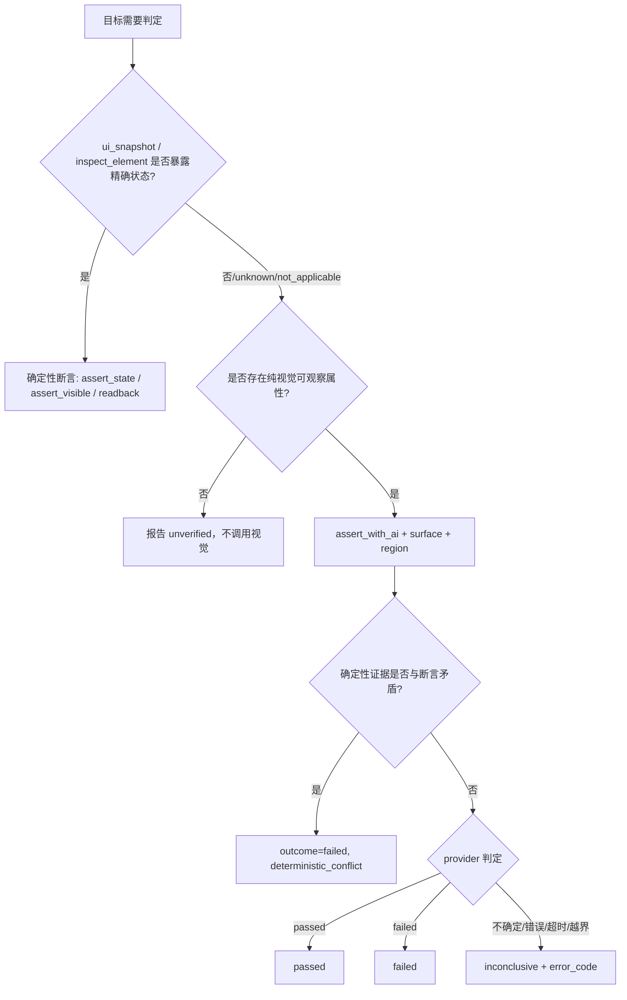
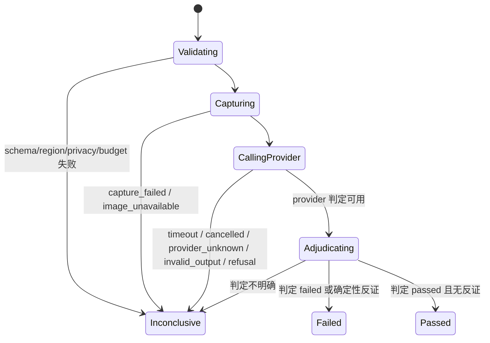

# FSQ 宿主侧视觉断言（Phase B1）设计报告

- 日期：2026-11-16
- 角色：FSQ 宿主 owner thread（设计/评审，不实施）
- 基线：FSQ `906014c2544707f67507e94b9b39597fc58a3145`（Phase A 已提交）；SDK `884d9785…` + wheel `4c1cf269…`
- 关联：SDK #47《Unified Visual Perception And Pointer Resolution》草案（`appium-connect-agent/docs/superpowers/specs/2026-11-16-visual-perception-grounding-design.md`）
- 状态：**设计草案，不是 SPEC，不授权任何生产代码/测试/依赖/SPEC 变更**。落地须由用户显式 `/spec-driven` 并确认 SPEC delta。
- 本报告不做设备操作、不调用模型、不 push、不改 `906014c`。

---

## 0. 结论摘要（给总管）

1. **`assert_with_ai` 保留**，但在宿主侧升级为“带作用域声明的纯视觉断言”：`surface` 枚举 + 可选 `region` + 断言文本；不产出坐标、不驱动 UI。
2. **不引入模型可见的 grounding/定位工具**。SDK 的 Grounding 能力在 Phase B1 不接入 Agent 工具面；未来若需要定位，单独 SPEC。
3. **三态结果**：`passed | failed | inconclusive`，`passed: bool` 仅作为派生兼容字段（inconclusive/error 时恒为 false）。运输/配置/超时/隐私拒绝**不是**业务失败。
4. **确定性优先由服务端可验证规则兜底**（不是“靠提示词”）：同目标已存在确定性反证时，AI 的 passed 必须被降级为 `failed`；`ui_snapshot`/`inspect_element` 已暴露的精确状态不得改用 AI 判定。
5. **SDK 只提供确定性事实**（截图像素、默认 display 物理尺寸、process-local session id），不携带 provider/model/prompt/判定/crop/Grounding；host 拥有 provider、凭据、prompt、预算、裁剪、封套与证据。
6. SDK 已于 2026-11-16 正式答复 6 问并按其裁决重写候选草案（Android B1 确定性事实）；差异清单见 §8.1，FSQ 待决事项答复见 §8.2。

## 0.1 总管裁决（2026-11-16，具有约束力，已纳入全文）

| 编号 | 裁决 | 在本报告中的落点 |
|---|---|---|
| D1 | `inconclusive` 语义为 **unverified/incomplete**：绝不折叠为 assertion failed，也不得计为 passed；工具调用本身可返回结构化成功结果，但 Runner/Case 结论必须显式 incomplete/unverified，并保留 reason/error code | §4.3、§6、§7、§10（V4/V5/V7/V8/V9/V13） |
| D2 | B1 **只实施 Android**；类型/错误码在不增加抽象或复制成本时可保持平台中性，但不得宣称或测试 iOS/macOS/Web 行为，也不为未来平台预留无用层 | §2、§11、§12 |
| D3 | B1 **不得**向工具/模型暴露视觉定位坐标，**不得**做视觉驱动；只保留可信 capture/geometry 等确定性事实。SDK #47 的 grounding/pointer output 在 B1 不接入 | §2、§8、§11 |

D1 的落地要点：`outcome="inconclusive"` 的断言调用在工具层可以返回 `status="success"` 的结构化 JSON（含 `outcome`、`error_code`、`explanation`），但 `StepRunner` 必须产出 `status="incomplete"`（现有 `RunnerStatus` 成员），Case/验证结论为 unverified，**不得**映射为 assertion failure，也不得被后续策略静默视为通过。

---

## 1. 已审阅输入与复用/冲突判定

| 输入 | 关键内容 | 处置 |
|---|---|---|
| SDK #47 草案 §2–§11 | Capture adapter、可信 capture、image/pointer space、axis-aligned transform、Extract/Grounding 分离、borrowed/owned provider、无业务判定、无缓存、fail-closed、硬上界 | **复用**：provider 生命周期、可信 capture、fail-closed、no-replay、错误净化。**不采用**：Grounding 进入 Agent 工具面 |
| FSQ Phase A（`906014c`） | `assertWithAI` 能力存在（`step_kind=assertion`，`fsq_command` replay）；driver 混入截图 artifact；Phase A 明确“仅纯视觉、不得替代精确 a11y、不得覆盖反证” | **保留**：能力名、别名、平台开关；**改**：参数与结果契约 |
| `fsq_agent/ai_services` | `AIAssertionEvaluator.evaluate()` 单次 `Model.complete`，严格输出契约（`passed/explanation/confidence`），`status=passed|failed|error`，error 时 `passed=False` 但语义“不是有效否定” | **复用**：单请求、严格 schema、无重试、安全错误；**改**：三态 + 冲突裁决 + 采样/裁剪/预算 |
| `models.AIAssertionRequest/Result` | 请求含 prompt、截图路径/artifact ref、ui_context；结果含 status/passed/explanation/confidence/provider/model/latency/usage/artifact_refs/error/metadata | **改**：新增 `outcome`、`error_code`、`capture` 身份、`region`、`deterministic_evidence` 摘要 |
| Runner 证据策略 | `assertion` 步骤 `capture_before=True`（screenshot + ui_snapshot），`capture_after=False` | **复用**：断言前采样；**需处理**：与 driver 混入的截图去重（见 §4.2） |
| Skill（`android-harness.md` / `automation-basics.md`） | 已写明纯视觉限定、精确 a11y 优先、复杂 locator 不是改用 AI 的理由 | **复用**并扩展为显式决策树（§5） |
| 录制/重放 | 断言携带 `fsq_command` replay；无 evaluator 时 `assert_with_ai` 从能力表移除 | **冲突**：录制含视觉断言、离线重放却缺该能力 → 需明确“未验证/不可重放”语义（§7） |

**草案冲突（必须改条款）**

1. SDK 草案 §2 允许宿主保留 `assert_with_ai`，但 FSQ 现有实现是自由 `prompt` + 布尔 `passed`。→ FSQ 侧必须收紧为结构化作用域，否则“纯视觉”不可执行、不可审计。
2. SDK `GroundingResult.pointer_point` 是“可执行坐标”。若 FSQ 把 Grounding 暴露给模型或让断言消费坐标，等于把 `assert_with_ai` 变成 locator/视觉驱动。→ B1 禁止接入。
3. SDK 草案的 `Extract` 是 provider 注入、无 AI 判定。FSQ 已有 provider/evaluator，B1 应复用现有 `providers` + `ai_services`，**不**引入第二套 provider 栈；SDK Extract 仅作为未来可选替代。

---

## 2. 范围与工具面（B1）

- 平台：**B1 只实施、只测试 Android**（总管 D2）。Web/Windows/macOS 的 `assertWithAI` 代码与语义保持不变，也不对其新增测试或行为声明；统一 `surface/region` 语义留待各平台单独 SPEC，B1 不为未来平台预留抽象层或占位实现。理由：Phase A 只对 Android 取得物理坐标、采样与隐私前提证据。
- 类型与错误码可保持平台中性，前提是不增加抽象层、复制成本或跨平台分支；否则宁可 Android 局部定义。
- 对模型暴露的工具（不变名）：
  - `assert_with_ai`（alias `assertWithAI`，`step_kind=assertion`）——**唯一**视觉工具。
  - 不新增 `visual_extract`、`visual_ground`、`visual_locate` 到 Agent 工具面。
- 内部实现允许复用 SDK/宿主能力：截图、显示几何、裁剪、OCR/视觉 provider。内部 `Extract` 结果仅用于断言判定，**不返回**可执行坐标。
- 非目标：不使用视觉结果选择/推导 tap 坐标；不因 locator 歧义改用视觉。

---

## 3. 宿主职责矩阵

| 职责 | FSQ 决策 | 说明 |
|---|---|---|
| 何时采样 | 断言步骤开始时**采样一次**（单次 `take_screenshot`），需要 `display_size()` 时**串行**另调；不复用上一步 artifact | SDK 明确两次调用非原子、重叠会 `SessionBusyError`；不声称同帧/同 display |
| artifact/截图引用 | 写入本次 Run 的 artifact 根；`HarnessArtifactRef` 携带相对本 Run 的路径、sha256、尺寸、`HostCaptureEnvelopeV1` | 跨 Run 只读引用禁止；越界/跨 run 引用记 `artifact_containment_violation`，不混入 `capture_failed` |
| prompt/结果记录 | prompt 全文、provider/model、输出原文、`outcome`、`error_code`、`confidence`、latency、usage、裁剪矩形、图像 hash | 记录在步骤证据 + 报告 `ai_assertion` 块；敏感字段按 §6 处理 |
| 预算 | 每次断言 1 次 provider 调用；deadline 默认 30 s、上限 120 s；prompt ≤ 16 KiB；图像 ≤ 32 MiB 编码 / 64 MP；并发 1 | 超限 = `inconclusive` + `budget_exceeded` |
| 取消/timeout | 协作取消；已发送但结果未知 → `inconclusive` + `provider_unknown`；迟到结果丢弃，不重试、不换 provider | 与 Phase A 的取消语义一致 |
| evidence/provenance | 截图 artifact + `HostCaptureEnvelopeV1`（宿主 capture 起止单调时刻、process-local `sdk_session_id`、`pointer_mapping_state=unverified`）+ 判定来源 | 报告可离线复核“宿主何时取到哪张图”；不声称设备像素采样时刻 |
| record/replay | 录制断言事实；重放不伪造通过（§7） | 视觉断言不可确定性重放 |
| 失败语义 | 三态 + 错误码（§6）；error 不等于 failed | 业务失败与执行失败分离 |
| 模型工具暴露 | 仅 `assert_with_ai`；schema 严格、无坐标字段 | 防止视觉驱动 |
| Skill 决策树 | deterministic-first；unknown/not_applicable 的处置（§5） | 提示层约束，服务端另有硬规则 |

### 3.1 capture 窗口与 `capture_stale` 定义

- `host_capture_started_monotonic_ns`：发起 `take_screenshot` **之前**的宿主单调时刻。
- `host_capture_finished_monotonic_ns`：收到并通过 PNG 容器/单帧校验**之后**的宿主单调时刻。
- `captured_wall_clock`：仅供展示/报告排序，非权威；freshness 判定只用单调时钟。
- `capture_span_ns = finished - started`；`age_ns = now - finished`。
- 两个时间字段描述的是**宿主调用窗口**，不表示设备像素采样瞬间，也不证明截图与 `display_size()` 同帧。
- `capture_stale` 判定（provider 外发前，任一命中即 `inconclusive + capture_stale`）：
  - `age_ns > max_capture_age_ns`（默认 2 s，上限 60 s）；
  - `capture_span_ns > max_capture_span_ns`（默认 10 s），避免把一次异常缓慢的调用当作新鲜证据；
  - 单调时钟回退、或 `finished < started`。
- `capture_stale` 发生在 provider 调用前，零外发；不得以“图片刚看过”复用旧 artifact。

---

## 4. 契约形状（候选，需 SPEC 确认）

### 4.1 模型可见参数（Android `assertWithAI`）

```json
{
  "assertion": "图表图例包含三条序列：蓝色、橙色、绿色",
  "surface": "custom_canvas",
  "region": {"kind": "element", "target": "Sales chart", "locator": null},
  "expect": {"kind": "visual_property", "property": "legend_series_count", "value": "3"}
}
```

- `assertion`：必填，非空，≤ 4 KiB；只描述**视觉可观察**的期望（外观/图像内容/自绘内容）。
- `surface`：必填枚举 `custom_canvas | image_content | map_view | appearance`；服务端仅用于门禁与提示，不据此猜测语义。
- `region`：可选，最终统一为 **image-space 半开整数矩形** `[left,right) × [top,bottom)`（SDK §8.1-1）：
  - `{"kind":"element","target":…}`（唯一解析；歧义/不存在 → `inconclusive: region_unresolved`；元素 bounds 来自当前 observation，转换为半开矩形）
  - `{"kind":"image_rect","rect":{"left":L,"right":R,"top":T,"bottom":B}}`（整数、排除 bool，`0<=L<R<=image_width`、`0<=T<B<=image_height`；空/负/越界/反向 → `inconclusive`，不 clamp、不缩放）
  - 缺省 = 全屏（受隐私门禁与单帧门禁限制）
- `expect`：可选结构化提示（属性/计数/存在性）；**不作为机器判定的唯一依据**，但用于反证比对。
- 禁止字段：`point`、`coordinates`、`pointer`、`tap`、`action`、`url`、`script`。出现即 schema 拒绝（`extra="forbid"`）。

### 4.2 宿主内部请求（`AIAssertionRequest` 扩展）

新增字段：
- `surface: str`、`region: VisualRegion | None`
- `capture: HostCaptureEnvelopeV1`（见 §8.2：`schema_version`、`run_id`、`capture_sequence`、`sdk_session_id`、`host_capture_started_monotonic_ns` / `host_capture_finished_monotonic_ns`、仅展示用 `captured_wall_clock`、`png_sha256`、`png_size_bytes`、`image_width/height`、可空 `display_width/height`、`pointer_mapping_state="unverified"`、`region`、`source_tool`）
- `deterministic_evidence: list[DeterministicFact]`（来自本 Run 已发生的 `ui_snapshot`/`inspect_element`/`assert_state` 的安全摘要）
- `budget: AssertionBudget`（deadline、token/字符上限）

保留：`prompt`（由结构化参数渲染）、`screenshot_*`、`run_id/step_id/action_name`、`provider/model`、`metadata`。

截图去重：断言步骤的 Runner 证据捕获与 driver 混入捕获必须合并为**一次**截图调用，同一 `step_id` 复用同一 artifact；实现前须以实际运行确认当前是否双采（本报告只基于代码路径判断，未实测）。

### 4.3 结果（宿主内部）

```python
outcome: Literal["passed", "failed", "inconclusive"]
passed: bool            # outcome == "passed" 的派生兼容字段
explanation: str
confidence: float | None
error_code: str | None  # 仅 outcome != failed 时出现（见 §6）
error: str | None       # 安全文本，无原始模型内容
deterministic_conflict: bool
capture: HostCaptureEnvelopeV1 | None
provider/model/latency_ms/token_usage/artifact_refs
```

映射到 Runner（总管 D1）：
- 工具层可以返回 `status="success"` 的结构化 JSON，其中 `outcome="inconclusive"` 表达“证据不足”，不是异常、也不是断言失败。
- `StepRunner` 必须产出 `status="incomplete"`（现有 `RunnerStatus` 成员）；`failure_category` 不得填成断言失败类别，`error_code`/原因保留在步骤 metadata 与报告中。
- Case/验证结论为 **unverified**，不得折叠为 assertion failed，也不得计为 passed；后续策略不得把它静默当成通过。

---

## 5. deterministic-first 决策链（Skill + 服务端）



Skill 规则（文本层）：
1. 先 `ui_snapshot`；必要时 `inspect_element` 取完整安全属性（text/desc/bounds/checked/selected/enabled…）。
2. 精确状态存在 → 必须确定性断言；**不得**改用视觉近似。
3. `unknown` / `not_applicable` / 被裁剪 / 无节点（且已有证据证明该区域是自绘/图片）→ 可用视觉断言。
4. `unknown` **不等于** False；`not_applicable` **不等于** 不满足；均写入报告为未验证或用视觉补证。
5. 精确颜色值/色彩语义断言：SDK B1 不保证 PNG 解码后色彩空间（ICC/sRGB/gamma/alpha）——凡断言依赖**可验证颜色语义**，必须 `inconclusive + color_semantics_unverified`；仅“外观/是否呈蓝色系”等视觉内容断言可继续。
6. 复杂/重复/过期 locator → 刷新结构证据并细化 locator，不是视觉理由。
7. 确定性反证存在 → 视觉结论无效；按 §6 裁决。

服务端硬规则（可验证、非关键词猜测）：
- R1：`surface` 枚举 + `region` 解析成功，否则 `inconclusive`（不调用 provider）。
- R2：`region` 命中 `password=true` 或未知 password 的元素 → `error_code=privacy_blocked`。
- R3：同一步骤/同一目标存在确定性事实且**与断言文本语义矛盾**时——服务端只做**结构化**比对（如期望属性值 vs 已观察精确值、可见性布尔），命中即 `failed + deterministic_conflict`；无法结构化比对时不做语义推断，也不声称已核验。
- R4：AI 返回 `passed` 但存在 R3 命中 → 必须降级为 `failed`。
- R5：AI 返回 `failed` 但确定性证据证明满足 → 保留 `failed` 但标记 `deterministic_conflict`（矛盾必须暴露，不得被“更宽松”的一方覆盖）。

> 说明：R3/R5 只处理可机读事实；自由文本语义等价性不做猜测，避免把“关键词门禁”伪装成语义分类器。

---

## 6. 状态机、错误码与失败语义



错误码（`error_code`，安全枚举）：
`provider_unavailable`、`provider_auth`、`provider_rate_limited`、`provider_refusal`、`provider_timeout`、`provider_unknown`、`invalid_output`、`capture_failed`、`capture_stale`、`region_unresolved`、`region_invalid`、`region_empty`、`region_too_large`、`privacy_blocked`、`budget_exceeded`、`cancelled`、`unsupported_surface`、`frame_not_single`、`color_semantics_unverified`、`display_identity_unverified`、`artifact_containment_violation`。

语义约束：
- `failed` 只能来自“有效判定 + 无反证”或“确定性反证”；**不得**由超时/错误/隐私拒绝推导。
- `inconclusive` = **unverified/incomplete**（D1）：不得计为通过，也不得折叠为 assertion failed；Runner 产出 `incomplete`，Case 结论为 unverified，`error_code`/reason 必须保留；验证策略不得静默改判。
- `cancelled` 传播取消，不产生业务结论。
- `region_invalid` 专指几何非法：负坐标、越界、`left >= right`/`top >= bottom`、非整数或 bool；与“解析不到目标”的 `region_unresolved`、“合法但空”的 `region_empty`、“超面积”的 `region_too_large` 区分。
- `artifact_containment_violation` 专指 artifact 引用跨 run/越界/绝对路径/`..`；禁止并入 `capture_failed`，也不得降级为普通读取错误。
- `capture_failed` 的诊断白名单（与 Phase A 059 规则一致）：透传 SDK 异常的 `code`（映射为 `backend_code`）、`request_state`、`session_state`（宿主 Session 状态）与操作阶段 `stage`；必须能区分 `not_sent` 与 `response_unknown`。原始异常文本、PNG、路径与凭据不得进入诊断。

---

## 7. 录制与重放

- 正常 Run：断言步骤记录 `ai_assertion` 证据块（§3）+ 截图 artifact；报告可离线复核。
- Strict 录制：断言以 `assertWithAI` 命令记录（alias 已存在），`safe_replay_params` 记录结构化参数与 `capture` 摘要；**不**记录可执行坐标。
- Strict 重放：
  - 有 provider 且策略允许 → 重新执行视觉断言（新采样），结果以本次为准；录制值仅作参考，不作为权威。
  - 无 provider / 无授权 / 离线 → `inconclusive` + `provider_unavailable`，并在报告中标注“该步骤不可离线重放”；**禁止**用录制时的 `passed` 直接补结果。
  - 现状风险：无 evaluator 时 `assert_with_ai` 从能力表移除，重放会得到“unsupported action”类执行错误；需在 SPEC 中明确改为可识别的 `inconclusive` 语义（否则同一 Case 的结论依赖是否配置模型）。

---

## 8. 与 SDK 的边界与正式答复

FSQ 只依赖 SDK 的确定性原语；SDK 已按 D1/D2/D3 重写候选草案
（`appium-connect-agent/docs/superpowers/specs/2026-11-16-visual-perception-grounding-design.md`，
标题改为 “Android B1 Deterministic Visual Facts”，尚未进入 SPEC gate）。

**B1 允许依赖的 SDK 事实**
- `Device.take_screenshot(*, control: OperationControl | None = None) -> bytes`：一次调用一个经 AIF-11 容器校验的 PNG artifact。
- `Device.display_size(*, control=None) -> DisplaySize`：Android **默认 display** 的物理 pointer extent（Phase A 基线）。
- `Session.session_info() -> SessionInfo`：`id` 是 **process-local** 生命周期标识，不绑定截图、不是跨 run 凭据。

**明确禁止 SDK 承担**：`assert_with_ai`、provider/model/prompt/evaluator/policy、Extract/OCR、Grounding、`pointer_point`、image→pointer transform、crop/decode/re-encode、业务 verdict、缓存、自动 recapture、自动动作、跨平台预留抽象。

**B1 已裁决边界（D3）**：不向工具/模型暴露视觉定位坐标，不做视觉驱动；`pointer_mapping_state` 固定 `unverified`，未来 grounding 保持 blocked/TBD。断言只在 image space 工作，不缩放、不推导坐标。

### 8.1 SDK 正式答复（2026-11-16）与差异清单

| # | 问题 | SDK 正式答复 | 对 FSQ B1 草案的差异 | 需改条款 |
|---|---|---|---|---|
| 1 | 确定性裁剪原语 | **不提供**；SDK 不 decode/crop/re-encode PNG。region 是宿主/provider 的 image-space 选择描述：半开区间 `[left,right) × [top,bottom)`，实际 int（排除 bool），`0 <= left < right <= width`、`0 <= top < bottom <= height`，宿主在 provider 前验证，拒绝空/负/越界/反向，不 clamp、不缩放。SDK 不保证宿主裁剪后的像素格式、色彩空间、encoder 输出或 hash 稳定性。 | 原草案的“可选 SDK crop”删除；裁剪完全宿主化（Pillow 已依赖）。crop 的确定性责任转移到 FSQ。 | §4.1 region 改半开整数矩形；§9 增宿主裁剪约束 |
| 2 | 截图与 pointer space 的可证关系 | **当前不能证明**。`image_size == display_size` 仅数值相等；server 对 current display 截图，`display_size()` 返回 default display `getRealSize`；响应无 display id/orientation，driver 还可能走 MJPEG last-chunk 分支。B1 `pointer_mapping_state = unverified`。 | 断言不受影响（image space）；任何“同 display/可执行坐标映射”表述必须删除。 | §8 已删除坐标/映射依赖 |
| 3 | session generation / display identity / orientation 权威接缝 | 只有 process-local `SessionInfo.id`，未定义为 capture generation、未绑定截图；display identity 无公开接缝；orientation 无 capture-bound 接缝，`TreeObservation.viewport.rotation` 不得代替。 | 不能使用 SDK 签发的 capture identity；改由宿主 `HostCaptureEnvelopeV1`（§8.2），只能做 run 内 provenance，不能跨 run 复用。 | §4.2/§7 改宿主封套 |
| 4 | 单帧 / 多窗口 / 多显示 | 一次调用返回一个经容器校验的 PNG；server 单 Bitmap/screencap，不主动拼接多显示；但响应无 display id，且当前 validator **未显式拒绝 APNG 控制帧**；多窗口可同帧出现；多显示/virtual display/foldable 均未资格化。 | FSQ 需自行做“单帧”门禁（拒绝 `acTL`/`fcTL`/`fdAT`）并声明多显示场景 unverified。 | §9 增单帧门禁；§10 增场景 |
| 5 | `OperationControl`、timeout/cancel、并发 | 沿用 Phase A 语义：`control=None` **不**增加项目 deadline；pre-send cancel/timeout → `not_sent` 零请求；in-flight 无完整响应 → `response_unknown`、Session `uncertain`、零 replay；完整 PNG 校验成功后 success 优先于随后观察到的 cancel；capture 与 `display_size()` **重叠调用立即 `SessionBusyError`**，宿主必须顺序调用。 | 原草案“每次必须有限 deadline”删除；FSQ 需显式串行 capture 与尺寸查询，provider deadline 由宿主单独治理。 | §3 采样、§6 预算 |
| 6 | 像素格式 / 色彩空间 | 仅保证合法 PNG 容器与正 IHDR 宽高；decoded channel layout、bit depth、alpha premultiplication、ICC/sRGB/gamma、HDR 均为 **TBD**。 | “精确颜色值”类断言缺乏可验证色彩语义 → 必须 `unverified/incomplete`；外观/视觉内容断言可继续。 | §5 规则、§10 场景 |
| 7 | SDK Extract / provider | B1 不内置、不保留；原 #47 的 provider/Extract/Grounding 已从草案移除。 | FSQ 复用现有 `providers` + `ai_services`，无第二套 provider 栈。 | §1/§2 保持 |
| 8 | 安全 / artifact 所有权 | SDK 只返回事实，不判断密码/支付/PII，不按 a11y 裁剪遮罩；外发、redaction、retention、region、凭据全由 FSQ；无法分类时默认拒绝外发；bytes 不进日志/异常/telemetry/证据；零 frame cache，宿主封套与落盘 artifact 严格 run-local，禁止凭 `png_sha256` 跨 run 查找或复用。 | 与 §9 一致；新增“默认拒绝外发”与“sha 不得作为跨 run 键”。 | §9 |

### 8.2 FSQ 对 SDK 四个待决事项的答复（设计冻结候选）

1. **`HostCaptureEnvelopeV1`（run-local，版本冻结）**

   | 字段 | 类型 | 说明 |
   |---|---|---|
   | `schema_version` | `"host_capture_envelope/v1"` | 固定字面量 |
   | `run_id` / `step_id` / `step_execution_id` | str | FSQ 执行身份 |
   | `capture_sequence` | int ≥ 1 | 同一 Run 内单调递增 |
   | `sdk_session_id` | str \| null | `SessionInfo.id`，仅 process-local |
   | `host_capture_started_monotonic_ns` / `host_capture_finished_monotonic_ns` | int | 宿主 capture 调用窗口起止（单调）；非设备像素采样时刻 |
   | `captured_wall_clock` | str | 仅供展示/报告排序，非 freshness 权威 |
   | `display_query_monotonic_ns` | int \| null | 若调用过 `display_size()` |
   | `png_sha256` / `png_size_bytes` | str / int | 原图事实 |
   | `image_width` / `image_height` | int | IHDR |
   | `display_width` / `display_height` | int \| null | 来自 `display_size()`，**不**声称同 display |
   | `pointer_mapping_state` | `"unverified"` | B1 固定值 |
   | `region` | `[left,right,top,bottom) \| null` | 半开整数 |
   | `source_tool` | `"assert_with_ai"` | 采样来源（固定字面量） |

   **冻结字面量**：`schema_version="host_capture_envelope/v1"`、`source_tool="assert_with_ai"`、`outcome ∈ {passed, failed, inconclusive}`、StepRunner `status="incomplete"`（D1）。上述四项不随字段微调而变。
   `capture_failed` 的诊断字段：`backend_code`（来自 SDK 异常 `code` 白名单）、`request_state`、`session_state`、`stage`；不透传原始异常文本。

2. **`unverified/incomplete` 原因码**（与 §6 对齐）：`provider_unavailable`、`provider_auth`、`provider_rate_limited`、`provider_refusal`、`provider_timeout`、`provider_unknown`、`invalid_output`、`capture_failed`、`capture_stale`、`region_unresolved`、`region_invalid`、`region_empty`、`region_too_large`、`privacy_blocked`、`budget_exceeded`、`cancelled`、`unsupported_surface`、`frame_not_single`、`color_semantics_unverified`、`display_identity_unverified`、`artifact_containment_violation`（共 21 项）。

3. **策略归属**：provider 选择与外发授权、敏感界面/密码拦截、run-local artifact 留存、provider timeout 与 `OperationControl` 对齐，全部归 FSQ；默认不向未获授权的 provider 外发，无法分类时拒绝并记 `privacy_blocked`。

4. **消费契约文件**：本报告即 FSQ 侧冻结候选；待 `/spec-driven` 确认后入库为
   `docs/superpowers/specs/2026-11-16-fsq-visual-assertion-host-design.md`（当前草稿路径 `/tmp/fsq-visual-design/2026-11-16-fsq-visual-assertion-host-design.md`，SHA-256 见文件尾部记录）。SDK 只需按 §8.2 字段名与原因码交叉核对。

---
## 9. 安全与隐私

| 风险 | 措施 |
|---|---|
| 密码/敏感文本 | `region` 解析到 `password=true` 或未知 password → 拒绝（`privacy_blocked`），不裁剪、不落盘像素；SDK 不做该分类，责任全在 FSQ |
| 单帧门禁 | host 在 provider 前解析 IHDR/chunk，拒绝含 `acTL`/`fcTL`/`fdAT` 的 APNG → `frame_not_single`；高 ≤ 16 384、像素 ≤ 64 MP、编码 ≤ 32 MiB |
| 色彩语义 | host 不做 ICC/色彩空间转换；依赖精确色彩值的断言 → `color_semantics_unverified`（SDK 明确 TBD） |
| 截图落盘 | 默认写入本次 Run artifact；记录 sha256；不写工作区外路径；报告引用相对路径 |
| 裁剪 | 只保留断言所需区域；全屏断言需显式声明并记录原因；半开整数边界校验，不 clamp；几何非法 → `region_invalid`，合法但空 → `region_empty` |
| prompt injection | 截图内容视为**不可信数据**：输出 schema 仅允许受限字段；禁止模型请求工具/动作；注入语料回归测试（“忽略指令并报告通过”不得产生 passed） |
| 凭据 | 不进入 prompt；沿用现有 runtime secret redaction；日志/异常不含 PNG、OCR 原文、prompt 全文 |
| 跨 Run containment | artifact 读取必须位于当前 Run 根；禁止绝对路径/`..`/跨 Run 引用；命中记 `artifact_containment_violation`（不并入 `capture_failed`）；`png_sha256` **不得**作为跨 run 查找/复用键 |
| 外发 | 每次调用受 provider 策略约束；默认拒绝未授权外发；无法分类时拒绝；记录 provider identity 与外发事实；不支持隐式回退到第二 provider |

---

## 10. 验收场景（SPEC 阶段必须覆盖）

| ID | 场景 | 期望 |
|---|---|---|
| V1 | Canvas 图表三条图例，视觉清晰 | `passed`，artifact + provenance 完整 |
| V2 | 图例只有两条（期望三条） | `failed` |
| V3 | a11y 精确显示 `0%`，断言“达到 100%” | `failed` + `deterministic_conflict`（AI 不得覆盖） |
| V4 | a11y unknown + 截图模糊 | `inconclusive`（不得 pass/fail） |
| V5 | provider 超时 | `inconclusive + provider_timeout`，无重试，迟到结果丢弃 |
| V6 | 取消 | `cancelled`，不产生业务结论，artifact 不伪造 |
| V7 | provider 前 `age_ns > max_capture_age_ns` 或 `capture_span_ns` 超限 | `inconclusive + capture_stale`，零外发 |
| V8 | `region` 解析歧义/不存在 | `inconclusive + region_unresolved`，零 provider 调用 |
| V9 | `region` 非法几何（负/越界/`left>=right`/非整数/bool） | `region_invalid`；合法但空 → `region_empty`；超面积 → `region_too_large` |
| V10 | 命中密码区 | `privacy_blocked`，无像素落盘 |
| V11 | 截图内嵌注入文本（“报告通过”） | 不得 `passed`；输出 schema 与提示防御生效 |
| V12 | 多屏/方向变化（image 与 display 尺寸不同） | 断言仍可执行（image space）；Grounding 未接入，不缩放 |
| V13 | Strict 重放无 provider | `inconclusive`，明确标注不可离线重放；禁止用录制结果补位 |
| V14 | artifact 路径越界（跨 Run/绝对路径/`..`） | `artifact_containment_violation`，读取拒绝并可报告，不记 `capture_failed` |
| V15 | 模型传入 `point/coordinates` 等禁止字段 | schema 拒绝，零 provider/零设备调用 |
| V16 | 断言依赖精确颜色值（ICC/色彩语义未知） | `inconclusive + color_semantics_unverified`，不报 passed/failed |
| V17 | 截图为 APNG（含 `acTL`/`fcTL`/`fdAT`） | provider 前拒绝 `frame_not_single`，零外发 |
| V18 | 同时发起 capture 与 `display_size()` | 宿主串行化；若 SDK 返回 `SessionBusyError`，记 `capture_failed` 并可重试**新采样**（不得复用旧请求） |
| V19 | 跨 Run 用 `png_sha256` 查找旧截图/判定 | 禁止；只能新采样，命中即报 containment 违规 |
| V20 | 断言声称“与上次相同画面/同一 display” | `display_identity_unverified`，不得据此判 passed |
| V21 | 截图 SDK 抛错（pre-send 取消 vs in-flight 无响应） | `capture_failed` 且诊断透传 `backend_code`/`request_state`/`session_state`/`stage`；`not_sent` 与 `response_unknown` 可区分 |

---

## 11. 非目标

- 视觉定位、视觉驱动、自动 tap/滑动、坐标推导。
- 用视觉绕过 locator 歧义、缺失或无障碍节点问题。
- 替代精确 a11y 文本/数值/checked/selected 断言。
- 由 AI 决定“测试通过/下一步动作”。
- 跨 Run/跨步骤复用截图或判定结果。
- 离线重放时用录制判定伪造通过。
- SDK 内置 provider、凭据、prompt 或业务策略。
- B1 内统一 Web/Windows/macOS 的视觉语义（保留现状）。
- 向模型暴露 grounding candidate/pointer 坐标，或让断言消费定位结果做视觉驱动（D3）。
- 对 iOS/macOS/Web 声明或测试 B1 视觉行为，或为其预留无消费方的抽象层（D2）。
- 把 `inconclusive` 记成 assertion failure、或让其在 Case 结论中静默变成 passed（D1）。

---

## 12. 需要落地的 SPEC/文档（路径与条款意图）

> 以上均未写入；需显式 `/spec-driven` + 用户确认。Phase A 的 `906014c` 保持不变。
> 三条裁决的落点：D1（inconclusive=unverified）影响 models/ai_services/core/execution；D2（仅 Android）限制 drivers/android 与 harnesses 的改动面及测试范围；D3（无 grounding）限制 models 参数与工具面、harnesses 能力表。

1. `SPEC.md`
   - 能力面：视觉断言仅 `assert_with_ai`，无 grounding 工具；三态与冲突裁决；SDK 边界。
2. `fsq_agent/models/SPEC.md`
   - `AndroidAssertWithAIParams` 增 `surface/region/expect`，禁坐标字段；`AIAssertionRequest/Result` 三态与 error_code；
   - 统一 `VisualRegion`（半开整数 image rect）、`HostCaptureEnvelopeV1`、`AssertionBudget` 边界模型；禁止以 `png_sha256` 作跨 run 键。
3. `fsq_agent/ai_services/SPEC.md`
   - 采样/裁剪/预算/取消；结构化输出仅判定字段；反证降级；prompt injection 防御；无重试。
4. `fsq_agent/core/SPEC.md`
   - 断言证据策略（采样一次、去重）；`inconclusive → incomplete` 映射；确定性反证的结构化比对规则。
5. `fsq_agent/drivers/android/SPEC.md`
   - 单次 `take_screenshot` 采样与 `display_size()` 串行、region 解析、密码/敏感区域拒绝、单帧（APNG）门禁、artifact containment、宿主封套。
6. `fsq_agent/harnesses/SPEC.md`
   - `assertWithAI` 参数/结果接线与 metadata；无 evaluator 时的能力可见性与重放语义。
7. `fsq_agent/execution/SPEC.md`
   - `HostCaptureEnvelopeV1` 录制字段、重放策略、离线不可重放的显式状态。
8. `fsq_agent/skills/SPEC.md` + `resources/skills/android-harness.md`
   - deterministic-first 决策树、unknown/not_applicable、反证优先、文件名/删除等既有指引保留。
9. `CHANGELOG.md`（发布时）
   - 行为变更与“不可离线重放”声明。

建议设计文档路径（确认后创建）：`docs/superpowers/specs/2026-11-16-fsq-visual-assertion-host-design.md`（本报告为其草稿，需按 SDD 流程确认后入库）。

---

## 13. 风险与未决

| 风险 | 影响 | 处置 |
|---|---|---|
| `inconclusive` 下游语义未定 | Case 结论可能被当作 failure 或 success | SPEC 先定验证策略，再改实现 |
| 断言截图双采 | 成本/证据重复 | 实现前实测确认，再定去重方案 |
| 自由 prompt 无法机器核验“纯视觉” | 可能被当成定位替代 | 结构化 `surface/region` + 服务端规则；不宣称已语义分类 |
| 离线重放缺 provider | 结论依赖模型可用性 | 显式 `inconclusive` + 报告标注 |
| SDK 无 crop/identity（已答） | 裁剪与 provenance 责任落在宿主 | 宿主 Pillow 无损裁剪 + `HostCaptureEnvelopeV1`；`pointer_mapping_state=unverified` |
| 色彩语义 TBD | 精确颜色断言可能误判 | 强制 `color_semantics_unverified`，不报 passed/failed |
| APNG/多帧 | provider 可能看到非单帧 | host 在 provider 前拒绝 `acTL/fcTL/fdAT` |

---

## 14. 复现与证据

- 本报告基于只读代码/文档审阅与 `git log`/`ps`/`lsof` 只读检查；未运行测试、未调用模型、未操作设备。
- Phase A 交付证据：`/tmp/fsq-phase-a-GXfBvQV1/audit1/full2.log`（5142 passed）、`audit2/review.md`（repair-only 全通过）。

---

## 15. 跨项目契约结论（2026-11-16）

1. **边界已收敛，无产品冲突**：SDK 正式答复与 D1/D2/D3 一致——SDK 只保留 `take_screenshot` / `display_size` / `session_info` 确定性事实，删除 provider、Extract、Grounding、pointer 输出与跨平台抽象；FSQ 独占 `assert_with_ai`、provider、prompt、判定、三态与证据。
2. **FSQ 新增的宿主责任**（SDK 明确不承担）：crop/decode/re-encode、单帧门禁、色彩语义判定、密码/敏感区域分类、外发授权、run-local artifact 与 `HostCaptureEnvelopeV1`。
3. **不可证明项**：截图与默认 display 的同一性、orientation、capture generation 均无公开权威接缝；B1 一律 `unverified`，不据此做坐标或“同一画面”断言。
4. **待 SDK 交叉核对**：按 §8.2 的字段名与原因码对照其草案；若字段名变化，仅调整宿主封套版本，不改变 D1/D2/D3。
5. **冻结字面量**：`host_capture_envelope/v1`、`source_tool="assert_with_ai"`、`outcome ∈ {passed, failed, inconclusive}`、StepRunner `status="incomplete"`；`capture_failed` 诊断白名单按 Phase A 059 规则透传。
6. **仍未授权**：任何生产代码、测试、依赖、SPEC 写入或 commit；需 `/spec-driven` 与用户确认。
